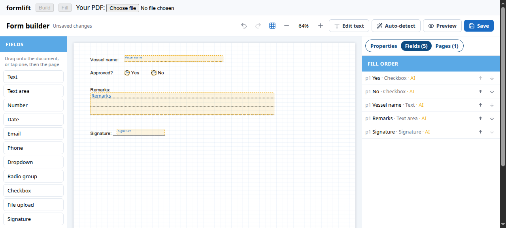
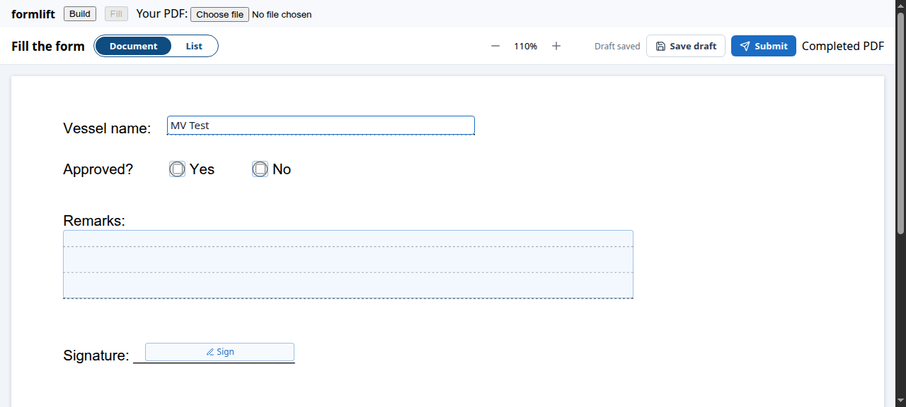

<div align="center">

# formlift

**Turn any PDF into a fillable web form, with no AI and no server-side conversion.**

Auto-detect fields · Drag-and-drop builder · Conditional logic · Validation · Fill-in UI · Completed PDF

[](https://www.npmjs.com/package/formlift)
[](https://www.npmjs.com/package/formlift)
[](https://www.npmjs.com/package/formlift)
[](./LICENSE)
[](https://github.com/harendra-singh-negi/formlift/actions/workflows/ci.yml)

**[▶ Live demo](https://harendra-singh-negi.github.io/formlift/)** · [Quick start](#quick-start) · [API](#api-reference) · [Server](#server-side) · [Theming](#theming) · [Your own UI](#your-own-ui) · [FAQ](#faq)



</div>

---

## Why formlift?

Most organisations already have their forms as PDFs: inspection checklists, onboarding sheets, permits, audit
reports. Rebuilding each one in a form tool takes days and loses the original layout.

**formlift keeps the PDF as it is** and puts real form fields on top of it:

1. **Upload** a PDF. formlift reads the page drawing and **suggests fields** for dotted lines, underlines,
   checkboxes, `____` blanks and empty table cells.
2. **Adjust** them in the builder: rename, retype, move, add rules and conditions.
3. **Publish.** People fill the form on the original page, on desktop or phone.
4. **Export** a completed PDF with the answers, signatures and attachments.

The original file is never modified. The whole form is plain JSON that you store wherever you like.

## Live demo

**[Try it in your browser →](https://harendra-singh-negi.github.io/formlift/)**

The demo runs the same components you install from npm:

1. **Build**: open a sample PDF or upload your own, review the suggested fields and edit them.
2. **Fill**: answer the form on the page or in the list view, then download the completed PDF.
3. **Code**: see the exact JSON your app receives from `onSave` and the code that wires it up.

Nothing is uploaded. Your PDF and answers stay in your browser. To run the demo locally, use `npm run dev`.

## Features

| | |
| --- | --- |
| 🔍 **Auto-detect** | Answer lines, checkboxes, typed blanks and table cells come from the PDF's own vector drawing. Sizes are measured relative to the text, so it works at any font size, scale or orientation. |
| 🧱 **Builder** | 20 field types (text, date & time, currency, multi-select, checklist, rating, slider, toggle, signature, file…), drag/resize/snap-to-grid, undo/redo, keyboard shortcuts, fill order, page reorder/insert/delete |
| ✏️ **Layout editing** | Add text, boxes and lines, or click any line of the original text to replace it, all without touching the file |
| 🔀 **Conditional logic** | `visibleWhen` / `requiredWhen` / `readOnlyWhen` with nested AND/OR groups and 10 operators. Circular rules are rejected. |
| ☑️ **Groups, follow-ups, comments** | Boxes that allow exactly one or several ticks, follow-up dialogs ("No" → ask why), 💬 comments per field, and an `onFieldChange` hook for your own logic. [Guide](#guide-groups-follow-ups-comments-and-your-own-logic) |
| ✅ **Validation** | Required, length, min/max, regex, email, phone, date and options. The **same code** runs in the browser and on your server. |
| 📱 **Filler** | Fields stay pinned to the page at every zoom, plus a list view with search and filters for phones. Includes autosave, signatures and file uploads. |
| 📄 **Completed PDF** | Answers, signature images and embedded attachments in a new PDF. Runs in Node, Bun, Deno, workers or the browser. |
| 🎨 **Isolated styling** | All CSS is scoped to `.fl-root` with no global reset, so it never clashes with your app (Tailwind included). Theme it with CSS variables. |
| 🧩 **Headless core** | Zero-dependency core you can use with any framework, or with none |
| 🟦 **TypeScript** | Written in TypeScript. Ships ESM, CommonJS and full type definitions. |

<div align="center">

</div>

## Packages

One install, four entry points. Import only what you use:

| Entry | Contents | Needs |
| --- | --- | --- |
| `formlift` | Types, validation, conditions, auto-detect, helpers | – |
| `formlift/react` | `<FormEditor>`, `<FormFiller>`, `<PdfPages>`, `setPdfWorker` | `react`, `react-dom` |
| `formlift/server` | `completedPdf()` | `pdf-lib` |
| `formlift/element` | `mountEditor()`, `mountFiller()` for Angular, Vue, Svelte or plain JS | – (React is bundled in) |
| `formlift/style.css` | Styles for the React components | – |

## Installation

```bash
npm install formlift
# or
pnpm add formlift
# or
yarn add formlift
```

Or install straight from GitHub (it builds on install), from a release tag or from a branch:

```bash
npm install github:harendra-singh-negi/formlift#v0.1.0
npm install github:harendra-singh-negi/formlift          # latest main
```

pdf.js (`pdfjs-dist` 5.x) is a peer dependency: npm 7+ and pnpm install it for you, and an app that already has
it shares that one copy (no second pdf.js, no worker version mismatch). Yarn 1 or an older npm: `npm install pdfjs-dist`.
Add only what your app does not have yet:

```bash
npm install react react-dom   # formlift/react, if your app is not already a React app
npm install pdf-lib           # formlift/server (completed PDF)
```

**Works in** Chrome / Edge 111+, Firefox 128+ and Safari 16.4+ (the CSS baseline of Tailwind v4, which builds the styles), React 18 and 19, Next.js App Router
(`formlift/react` is marked `"use client"`; `formlift/server` stays server-safe) and TypeScript with any
`moduleResolution` (`bundler`, `node16`, `nodenext`). Long documents stay light: only the pages near the screen are
drawn and carry their fields, so a 300-page form with thousands of fields scrolls like a short one.

Angular, Vue, Svelte or plain JS: use `formlift/element`, which needs nothing else.

**Requirements:** React 18 or 19 (only for `formlift/react`) · Node 18+ · browsers with CSS `@scope` support (Chrome/Edge 118+,
Safari 17.4+, Firefox 128+).

## Quick start

### 1. Configure pdf.js (once, at app start)

```ts
import { setPdfWorker } from 'formlift/react'
import 'formlift/style.css'

// Vite
import workerUrl from 'pdfjs-dist/build/pdf.worker.min.mjs?url'
setPdfWorker(workerUrl)

// webpack 5 / Next.js
// setPdfWorker(new URL('pdfjs-dist/build/pdf.worker.min.mjs', import.meta.url).toString())
```

> If you skip this step, the worker is loaded from unpkg.com for the installed pdfjs-dist version. That works,
> but it needs internet access and is blocked by a strict CSP.

### 2. Build a form (admin)

```tsx
import { FormEditor, type FormDoc } from 'formlift/react'

export function FormBuilder({ pdfUrl, saved }: { pdfUrl: string; saved?: FormDoc }) {
  return (
    <div style={{ height: '100vh' }}>
      <FormEditor
        pdf={pdfUrl}
        initialValue={saved}
        title="Crew onboarding"
        onSave={(doc) =>
          fetch('/api/forms/42', {
            method: 'PUT',
            headers: { 'Content-Type': 'application/json' },
            body: JSON.stringify(doc),
          })
        }
      />
    </div>
  )
}
```

### 3. Fill it (users)

```tsx
import { FormFiller, type FormDoc } from 'formlift/react'

export function FillForm({ pdfUrl, form }: { pdfUrl: string; form: FormDoc }) {
  return (
    <div style={{ height: '100vh' }}>
      <FormFiller
        pdf={pdfUrl}
        fields={form.fields}
        layout={form.layout}
        onSave={async (answers, { submit }) => {
          const res = await fetch('/api/forms/42/answers', {
            method: 'POST',
            headers: { 'Content-Type': 'application/json' },
            body: JSON.stringify({ answers, submit }),
          })
          // Throw { errors: { fieldKey: message } } and the messages appear at the fields
          if (!res.ok) throw await res.json()
        }}
        onSubmitted={() => alert('Thank you!')}
      />
    </div>
  )
}
```

That's it. Both components fill the height of their container.

### Angular, Vue, Svelte or plain JS

`formlift/element` has React inside, so your app installs only `formlift`:

```ts
import { mountEditor, mountFiller, setPdfWorker } from 'formlift/element'
import 'formlift/style.css' // or add it to your global styles

// Builder: the form is plain JSON, store it wherever you like
const editor = mountEditor(element, {
  pdf: '/files/form.pdf',
  initialValue: saved,              // { fields, layout } from your store
  onSave: (doc) => api.saveForm(doc),
  limits: { maxFields: 20000 },
})
editor.update({ stickyToolbar: false }) // change options later
editor.unmount()                        // e.g. in ngOnDestroy

// Fill-in: answers come out as JSON on every change, no server needed
const filler = mountFiller(element, {
  pdf: '/files/form.pdf',
  fields: saved.fields,
  layout: saved.layout,
  onChange: (answers) => console.log(answers), // { fieldKey: value }
})
```

Options are the same as the `<FormEditor>` / `<FormFiller>` props below, except the ones that take React content
(`toolbar`, `banner`, `tabs`, `components`); `title` is plain text. `mountEditor` also returns `save()`, `dirty` and
`value`. Give the element a height: the components fill it.

## Guide: groups, follow-ups, comments and your own logic

Four tools, from no code to full control. Pick the first one that does the job:

| You want… | Use | Code needed |
| --- | --- | --- |
| Separate boxes where only one (or 2–3, or all) may be ticked | [Groups of boxes](#groups-of-boxes) | none: set in the editor |
| More fields on the page when an answer is given | [`visibleWhen`](#data-model) | none: Conditions in the editor |
| A dialog asking more questions ("No" → why, by when) | [Follow-up dialogs](#follow-up-dialogs) | none: set in the editor |
| A 💬 per field where people leave remarks | [Comments](#comments) | store `info.comments` |
| Anything else: fill other fields, call your API, your own dialog | [`onFieldChange`](#your-own-logic-onfieldchange) | a function |
| Your own icon or button next to a field (React) | [`renderFieldExtras`](#your-own-logic-onfieldchange) | a component |

Everything is part of the form JSON (`FieldDef`), checked by `validateFields`, and enforced by `validateAnswers` in the
browser **and on your server**.

### Groups of boxes

A PDF often has "☐ Yes ☐ No ☐ N/A" as separate boxes. Put them in a group:

- **Editor:** select a box → *Group of boxes* → **New group…**, then select each other box → pick the same group.
  Choose *Exactly one* or *Several*, tick *An answer is required*, and for *Several* set *Choose at least / at most*.
- **JSON:** every member carries the same `group`:

```ts
{ key: 'cert_yes', type: 'checkbox', group: { id: 'cert', mode: 'single', required: true }, /* … */ }
{ key: 'cert_no',  type: 'checkbox', group: { id: 'cert', mode: 'single', required: true }, /* … */ }
// mode 'multiple': any number, with min / max: { id: 'hazards', mode: 'multiple', min: 1, max: 3 }
```

| mode | While filling | Checked on submit (browser + server) |
| --- | --- | --- |
| `single` | Ticking one unticks the others | Exactly one when `required`; never two |
| `multiple` | Free | At least `min` (1 when `required`), at most `max` |

The error shows at the group's first visible box. Members hidden by a condition don't count. Answers stay one boolean
per box. Groups work for `checkbox` and `toggle`. (`radio` is one-of-many already; `checklist` / `multiselect` have
`min` / `max` built in.) Your own UI applies the rule with `applyAnswer(fields, answers, field, value)`.

### Follow-up dialogs

"If the answer is **No**, ask for the reason and a due date":

- **Editor:** select the field → *Follow-up questions* → **Add a question** (pick a type; repeat for more). Set
  *Ask when* (e.g. *this field* · *equals* · `No`) and optionally a *Dialog heading*. Click a question in the list
  to edit its label, rules and so on.
- **JSON:**

```ts
{
  key: 'cert_ok', type: 'radio', options: ['Yes', 'No'], /* … */
  followUp: {
    when: { logic: 'and', rules: [{ fieldKey: 'cert_ok', op: 'equals', value: 'No' }] },
    title: 'Why not?',
    fields: ['cert_reason', 'cert_due'],
  },
}
{ key: 'cert_reason', type: 'textarea', dialogOnly: true, required: true, /* … */ }
{ key: 'cert_due',    type: 'date',     dialogOnly: true, /* … */ }
```

- **While filling:** the dialog opens when the person's change makes `when` true. A ⊕ badge next to the field shows
  how many follow-up answers there are and reopens the dialog. It turns red when one of them has an error.
- **Answers:** ordinary answers under their own keys (`cert_reason`, `cert_due`), with their own validation. They count
  only while the follow-up is open: `required` applies then, and they are skipped otherwise. `fieldStates` and
  `validateAnswers` handle this, so the server agrees.
- **Completed PDF:** dialog-only fields have no box on the page. They are printed on an *Additional answers* page at the
  end, under the field that asked them (e.g. "Certificates OK (page 3)").
- Deleting a field removes its follow-up questions; renaming one keeps the follow-up pointing at it.

### Comments

- **Editor:** tick *Allow comments* on a field (JSON: `comments: true`).
- **While filling:** a 💬 next to the field shows the count. Clicking it opens the comments: each with author and time,
  plus a box to add one. Deleting is possible unless the filler is `readOnly`.
- **Storing:** comments are kept apart from the answers (a conversation, not an answer):

```tsx
<FormFiller
  fields={form.fields}
  initialAnswers={draft.answers}
  initialComments={draft.comments}      // Comments: { [fieldKey]: { id, text, by?, at }[] }
  commentAuthor={currentUser.name}      // stored as `by`
  onSave={(answers, { submit, comments }) => api.save({ answers, comments, submit })}
  onCommentsChange={(comments) => {/* optional: live */}}
/>
```

- **Server:** `cleanComments(form.fields, req.body.comments)` keeps only fields that allow comments and well-formed
  entries (at most `limits.maxComments` per field, default 200).
- **Completed PDF:** pass them to print a *Comments* page:
  `completedPdf(original, fields, answers, files, layout, { comments })`.

### Your own logic: `onFieldChange`

Runs after the person changes a field (not after your own `setAnswer`), with the answers after the change:

```tsx
<FormFiller
  fields={form.fields}
  onFieldChange={(field, value, api) => {
    // fill another field
    if (field.key === 'vessel') api.setAnswer('imo', lookupImo(String(value)))
    // ask dialog-only fields your way (they need no follow-up)
    if (field.key === 'incident' && value === true) api.openDialog(['incident_time', 'incident_place'], 'Incident details')
    // tell the person something
    if (field.key === 'expiry' && String(value) < today) api.notify('This certificate has expired')
  }}
  renderFieldExtras={(field, { answers }) =>        // React only: your icon / button next to a field
    field.key === 'imo' ? <a href={`https://registry.example/${answers.imo}`}>🔗</a> : null}
/>
```

`api` = `{ answers, setAnswer(key, value), openDialog(keys, title?), notify(message) }`. Answers set this way are
ordinary answers: saved, validated and printed like any other. Dialog-only fields not used by any follow-up are
always counted, so give them `visibleWhen` if they apply only sometimes.

**Angular / Vue / plain JS:** `onFieldChange`, comments and everything above work the same through
`mountFiller(el, { ... })`. `renderFieldExtras` is React-only.

## Server side

**Never trust the browser.** Run the same checks on your server with the core package:

```ts
import express from 'express'
import { cleanAnswers, cleanComments, validateAnswers, validateFields, validateLayout } from 'formlift'
import { completedPdf } from 'formlift/server'

const app = express().use(express.json({ limit: '5mb' }))

// Save a form definition
app.put('/api/forms/:id', async (req, res) => {
  const { fields, layout } = req.body
  const pageCount = await pagesOfUploadedPdf(req.params.id)
  const problems = [...validateFields(fields, pageCount), ...(layout ? validateLayout(layout, pageCount) : [])]
  if (problems.length) return res.status(400).json({ problems })
  await db.forms.update(req.params.id, { fields, layout })
  res.sendStatus(204)
})

// Save or submit answers
app.post('/api/forms/:id/answers', async (req, res) => {
  const form = await db.forms.get(req.params.id)
  const answers = cleanAnswers(form.fields, req.body.answers) // drops unknown keys, coerces types
  const comments = cleanComments(form.fields, req.body.comments) // only fields with comments: true
  if (req.body.submit) {
    const errors = validateAnswers(form.fields, answers) // {} = valid; hidden fields and closed follow-ups are skipped
    if (Object.keys(errors).length) return res.status(422).json({ errors })
  }
  await db.submissions.save(req.params.id, { answers, comments }, req.body.submit)
  res.sendStatus(204)
})

// Download the completed PDF
app.get('/api/submissions/:id/pdf', async (req, res) => {
  const { form, answers, comments, files } = await db.submissions.full(req.params.id)
  const pdf = await completedPdf(form.originalPdf, form.fields, answers, files, form.layout, { comments })
  res.type('application/pdf').send(Buffer.from(pdf))
})
```

`files` maps a file answer's id to `{ fileName, fileType, bytes }`. Signatures are drawn as images and
uploads are embedded as PDF attachments. Follow-up answers and comments go on pages at the end.

## API reference

### `<FormEditor>`

| Prop | Type | Default | Description |
| --- | --- | --- | --- |
| `pdf` | `PdfSource` | **required** | The PDF: a URL, `Blob`/`File`, `ArrayBuffer`, `Uint8Array`, or an (async) function that returns one |
| `onSave` | `(doc: FormDoc) => unknown` | **required** | Called on Save. Throw or reject to keep the changes marked unsaved. |
| `initialValue` | `FormDoc` | empty | The saved form. To load a different one, remount with a new `key`. |
| `onChange` | `(doc: FormDoc) => void` | – | Called on every change, including undo and redo |
| `autoDetect` | `boolean` | new forms only | Runs field detection when the PDF opens |
| `title` | `ReactNode` | – | Toolbar title |
| `onBack` | `() => void` | – | Shows a Back button |
| `toolbar` | `ReactNode` | – | Your buttons at the end of the toolbar, such as a workflow status or Publish |
| `banner` | `ReactNode` | – | A strip under the toolbar |
| `tabs` | `{ id, label, content }[]` | `[]` | Extra tabs in the side panel, such as History |
| `notify` | `(msg: string) => void` | no-op | Success messages: connect your toast system here |
| `onError` | `(err: unknown) => void` | `console.error` | Error messages |
| `className` | `string` | `'h-full'` | Classes on the root element |
| `ref` | `Ref<FormEditorHandle>` | – | `{ save(), dirty, value }`, for example to save before a workflow step |
| `hide` | `EditorPart[]` | `[]` | Parts to leave out: `back`, `title`, `status`, `undo`, `snap`, `zoom`, `editText`, `autoDetect`, `preview`, `save`, `tools`, `fieldTools`, `layoutTools`, `panel`, `propertiesTab`, `fieldsTab`, `pagesTab`, `problems` |
| `fieldTypes` | `FieldType[]` | all | Field types that can be added |
| `elementTools` | `ElementTool[]` | all | Layout tools that can be added (`[]` = none) |
| `components` | `FormliftComponents` | – | Replacement UI components and answer controls ([Your own UI](#your-own-ui)) |
| `labels` | `Partial<Labels>` | English | Your own text for every button, heading and message (any language) ([Labels](#labels-text-and-language)) |
| `keyboard` | `boolean` | `true` | Keyboard shortcuts |
| `warnUnsaved` | `boolean` | `true` | Browser warning when leaving with unsaved changes |
| `onDetected` | `(found: FieldDef[]) => void` | – | Called with the fields auto-detect suggested |
| `limits` | `Partial<Limits>` | `DEFAULT_LIMITS` | Size limits checked before saving, such as `{ maxFields: 20000 }` ([Limits](#limits)) |
| `snapStep` | `number` | `0.005` | Snap-to-grid step as a fraction of the page |
| `undoLimit` | `number` | `100` | Undo steps kept |
| `zoomSteps` | `number[]` | `[0.5, 0.75, 1, 1.25, 1.5, 2]` | Steps of the zoom − / + buttons |
| `stickyToolbar` | `boolean` | `true` | Keep the toolbar on top when the page around the editor scrolls |
| `stickyPanels` | `boolean` | `true` | Only the document scrolls; the tools and right panel stay in view. `false` scrolls the whole editor as one page |

**Keyboard:** <kbd>Del</kbd> delete · <kbd>Ctrl</kbd>+<kbd>Z</kbd> / <kbd>Ctrl</kbd>+<kbd>Y</kbd> undo/redo ·
<kbd>Ctrl</kbd>+<kbd>D</kbd> duplicate · arrow keys nudge (hold <kbd>Shift</kbd> for larger steps) ·
<kbd>Esc</kbd> deselect

### `<FormFiller>`

| Prop | Type | Default | Description |
| --- | --- | --- | --- |
| `pdf` | `PdfSource` | **required** | The PDF |
| `fields` | `FieldDef[]` | **required** | The form's fields |
| `layout` | `Layout \| null` | `null` | The form's layout (`null` = the original pages) |
| `initialAnswers` | `Answers` | field defaults | A draft to continue |
| `onSave` | `(answers, { submit, comments }) => unknown` | – | Called for drafts and autosave (`submit: false`) and for submit (`true`). Throw `{ errors }` to show field errors. |
| `onSubmitted` | `(answers) => void` | – | Called after a successful submit |
| `autosave` | `number \| false` | `2500` | Delay in ms after the last change |
| `onUpload` | `(field, file) => Promise<AnswerFileInfo>` | – | Stores an uploaded file or a signature PNG and returns its `id`. Without it, file fields are read-only and signatures are kept as data URLs. |
| `loadFile` | `(id) => Promise<Blob>` | – | Loads stored signatures and opens attachments |
| `files` | `AnswerFileInfo[]` | `[]` | Files already attached to the draft |
| `readOnly` | `boolean` | `false` | View a submitted form |
| `hide` | `FillerPart[]` | `[]` | Parts to leave out: `back`, `title`, `views`, `zoom`, `saveStatus`, `saveDraft`, `submit`, `attachments`, `errors`, `requiredMark` |
| `views` | `('document' \| 'list')[]` | both | Views offered; the first is shown first |
| `confirmSubmit` | `boolean` | `true` | Ask "Submit this form?" first |
| `listFilters` | `(FilterSource \| string)[]` | `defaultFilters` | The list view's filters ([Filters](#4-filters-you-choose-formlift-computes)) |
| `listSearch` | `boolean` | `true` | Search box over the list |
| `hideUnavailableFilters` | `boolean` | `true` | Leave out filters this form has nothing for |
| `renderFilters` | `(fs: QuestionFilterState) => ReactNode` | – | Your own search / filter bar instead of the built-in one |
| `toQuestions` | `(fields, textOf) => Question[]` | `toQuestions` | How fields become list questions |
| `components` | `FormliftComponents` | – | Replacement UI components and answer controls |
| `labels` | `Partial<Labels>` | English | Your own text for every button, heading and message (any language) ([Labels](#labels-text-and-language)) |
| `limits` | `Partial<Limits>` | `DEFAULT_LIMITS` | Size limits for answers ([Limits](#limits)) |
| `zoomSteps` | `number[]` | `[0.5, 0.75, 1, 1.25, 1.5, 2]` | Steps of the zoom − / + buttons |
| `listPageSize` | `number` | `100` | Questions shown per "Show more" step in the list view |
| `stickyToolbar` | `boolean` | `true` | Keep the toolbar on top while the content scrolls; `false` lets it scroll away |
| `onChange` | `(answers: Answers) => void` | – | Every change of the answers as JSON. With it, `onSave` is optional |
| `messages` | `Partial<AnswerMessages>` | English | Your own wording for answer errors (any language) |
| `onFieldChange` | `(field, value, api) => void` | – | Your logic after each change: `api.setAnswer`, `api.openDialog`, `api.notify` ([Guide](#your-own-logic-onfieldchange)) |
| `initialComments` | `Comments` | `{}` | Comments to start with ([Comments](#comments)) |
| `onCommentsChange` | `(comments: Comments) => void` | – | Every change of the comments (they also reach `onSave` as `info.comments`) |
| `commentAuthor` | `string` | – | Stored as `by` on new comments |
| `renderFieldExtras` | `(field, { answers, readOnly }) => ReactNode` | – | Your own icon / button next to a field (React only) |
| `title`, `onBack`, `toolbar`, `notify`, `onError`, `className` | | | Same as `FormEditor` |

### Hooks (`formlift/react`)

| Hook | Gives |
| --- | --- |
| `useFormEditor(options)` | Everything `FormEditor` does, without UI: document, undo/redo, selection, drag/resize, pages, detect, save |
| `useFormFiller(options)` | Everything `FormFiller` does, without UI: answers, conditions, validation, autosave, uploads, questions |
| `useQuestionFilter(questions, answers, options)` | Search and filters as data: `groups`, `inUse`, `list` |

### Core functions (`formlift`)

| Function | Returns | Description |
| --- | --- | --- |
| `validateFields(fields, pageCount, limits?)` | `string[]` | Problems in a form definition: shapes, unique keys, positions, options, regexes, condition references and cycles |
| `validateLayout(layout, pageCount, limits?)` | `string[]` | Problems in a layout |
| `validateAnswers(fields, answers, options?)` | `Record<key, message>` | Problems in the answers, with conditions applied |
| `cleanAnswers(fields, input)` | `Answers` | Keeps only known keys with the right value types |
| `checkAnswer(field, value, required, options?)` | `string \| null` | Checks a single answer |
| `fieldStates(fields, answers)` | `Record<key, { visible, required, readOnly }>` | Applies the conditions |
| `evaluate(condition, answers)` | `boolean` | Evaluates one condition |
| `defaultAnswers(fields)` | `Answers` | The answers a new submission starts with |
| `applyAnswer(fields, answers, field, value)` | `Answers` | The answers after one change, with group rules applied (use it in your own UI) |
| `openedFollowUps(fields, before, after)` | `FieldDef[]` | Fields whose follow-up this change opened |
| `groupsOf(fields)` | `Map<id, { group, members }>` | Groups of boxes |
| `cleanComments(fields, input, limits?)` | `Comments` | Comments kept to fields that allow them, well-formed |
| `answerText(field, value)` | `string` | An answer as people read it ("Fire, Flood", "$12.50", "Yes") |
| `withoutField(fields, id)` / `newFollowUpField(type, trigger, fields)` | `FieldDef[]` | Remove a field (with its follow-up questions) / add a follow-up question |
| `defaultLayout(pageSizes)` | `Layout` | The layout of an untouched document |
| `detectDocument(pdf, OPS, pages, existing, onProgress?, signal?)` | `Promise<FieldDef[]>` | Suggests fields for a whole document |
| `toQuestions(fields, textOf?, { categoryCode? })` | `Question[]` | Fields grouped as questions, used by the list view |
| `filterQuestions(questions, answers, filters, values, search?)` | `Question[]` | The questions passing a search and picked filter values (see [Filters](#4-filters-you-choose-formlift-computes)) |

### Limits

Every size limit has a default and can be changed without a new formlift version. Pass only the values you
want to change, and pass the **same** values in the browser and on your server:

```ts
import { DEFAULT_LIMITS, type Limits } from 'formlift'

const limits: Partial<Limits> = { maxFields: 20000 } // a 300+ page checklist

<FormEditor limits={limits} ... />
<FormFiller limits={limits} ... />
validateFields(fields, pageCount, limits) // server
validateAnswers(fields, answers, limits)  // server
```

| Limit | Default | Checked by |
| --- | --- | --- |
| `maxFields` | 5000 | `validateFields`, FormEditor save |
| `maxPages` | 1000 | `validateLayout`, FormEditor save |
| `maxElements` | 5000 | `validateLayout` (text / box / line items) |
| `maxElementText` | 5000 | `validateLayout` (characters in one layout text) |
| `maxAnswerLength` | 10000 | `checkAnswer`, `validateAnswers`, FormFiller |
| `maxSignatureChars` | 300000 | `checkAnswer` (signature saved as a PNG data URL) |

### Validation

formlift checks answers with its built-in rules (required, length, min/max, regex, email, phone, date, options).
You can change every part of it, and the same code runs in the browser and on your server:

| What | How |
| --- | --- |
| Your wording or language for every built-in message | `messages: { required: (label) => label + ' ज़रूरी है', email: '…' }` (`DEFAULT_ANSWER_MESSAGES` has them all) |
| A message for one field | In the builder, or in JSON: `requiredMessage`, `errorMessage` on the field |
| Your own rules, picked per field in the builder | `rules: { imo: { label: 'IMO number', check: (value, field, answers) => ... } }`; the field stores `rules: ['imo']` |
| Rules for some field types only | `types: ['text', 'number']` on a rule |
| Full control | `validate: (field, value, answers) => 'message' \| null \| undefined`: a message is the error, `null` accepts the answer, `undefined` lets formlift check as usual |

```ts
import { validateAnswers, type AnswerOptions } from 'formlift'

const validation: AnswerOptions = {
  rules: {
    imo: { label: 'IMO number', types: ['text'], check: (v) => (/^\d{7}$/.test(String(v)) ? null : 'IMO must be 7 digits') },
    afterStart: { label: 'After start date', types: ['date'], check: (v, f, a) => (v > a.startDate ? null : 'Must be after the start date') },
  },
}

<FormEditor rules={validation.rules} ... />    // the admin picks rules per field
<FormFiller {...validation} ... />             // rules, messages, validate
validateAnswers(fields, answers, validation)   // your server: same rules
```

Rules get every answer, so they can compare fields. They are not called for empty answers (that is `required`).
A rule name the app does not know is skipped, so give the server the same `rules` as the browser.

### Labels (text and language)

Every text formlift shows (buttons, headings, hints, messages) can be replaced. Pass only the ones you want;
the rest stay English. `DEFAULT_LABELS` lists them all; texts with a number in them are functions:

```tsx
import { DEFAULT_LABELS, type Labels } from 'formlift/react'

const hindi: Partial<Labels> = { save: 'सहेजें', submit: 'जमा करें', saveDraft: 'ड्राफ्ट सहेजें', fieldsTab: (n) => `फ़ील्ड (${n})` }

<FormFiller labels={hindi} ... />
<FormliftProvider labels={hindi}>...</FormliftProvider> // or for everything under it
```

Answer errors ("Name is required"…) come from the `messages` prop (`Partial<AnswerMessages>` from
`'formlift'`, defaults in `DEFAULT_ANSWER_MESSAGES`), which FormFiller accepts too.

### Server (`formlift/server`)

```ts
completedPdf(
  original: Uint8Array | ArrayBuffer,
  fields: FieldDef[],
  answers: Answers,
  files?: Record<string, { fileName: string; fileType: string; bytes: Uint8Array }>,
  layout?: Layout | null,
  options?: { comments?: Comments; text?: { moreAnswers, comments, page, yes, no } }, // headings in your language
): Promise<Uint8Array>
```

### Data model

A form is plain, serialisable JSON:

```ts
type FormDoc = { fields: FieldDef[]; layout: Layout | null }

interface FieldDef {
  id: string
  key: string // answer key: starts with a letter; letters, digits and _
  type: 'text' | 'textarea' | 'number' | 'date' | 'time' | 'datetime' | 'email' | 'phone' | 'url'
      | 'currency' | 'dropdown' | 'radio' | 'multiselect' | 'checklist' | 'checkbox' | 'toggle'
      | 'rating' | 'slider' | 'file' | 'signature'
  label: string
  source: 'manual' | 'ai' // 'ai' = suggested by auto-detect
  confidence?: number
  position: { page: number; x: number; y: number; width: number; height: number } // 0..1 of the page, origin top-left
  placeholder?: string
  helpText?: string
  defaultValue?: string
  required?: boolean
  readOnly?: boolean
  hidden?: boolean
  minLength?: number
  maxLength?: number
  min?: number // number / currency / slider; multiselect / checklist: fewest choices
  max?: number // number / currency / slider; multiselect / checklist: most choices; rating: stars (default 5)
  step?: number // slider (default 1)
  currency?: string // currency: symbol before the amount (₹, $, €)
  decimals?: number // currency: digits after the point (default 2)
  pattern?: string
  options?: string[] // dropdown, radio, multiselect, checklist
  visibleWhen?: Condition
  requiredWhen?: Condition
  readOnlyWhen?: Condition
  group?: { id: string; mode: 'single' | 'multiple'; required?: boolean; min?: number; max?: number } // checkbox / toggle
  followUp?: { when: Condition; title?: string; fields: string[] } // keys of dialogOnly fields
  dialogOnly?: boolean // asked in a dialog, no box on the page
  comments?: boolean // people can comment on it
}

type Comments = Record<string, { id: string; text: string; by?: string; at: string }[]> // by field key

interface Condition {
  logic: 'and' | 'or'
  rules: (Rule | Condition)[]
}

interface Rule {
  fieldKey: string
  op: 'equals' | 'notEquals' | 'contains' | 'startsWith' | 'endsWith'
    | 'greaterThan' | 'lessThan' | 'between' | 'isEmpty' | 'isNotEmpty'
  value?: string
  value2?: string // upper bound for 'between'
}

type Answers = Record<string, string | boolean | null>
// checkbox / toggle → boolean · file / signature → your file id
// multiselect / checklist → the chosen options as a JSON array string: '["Fire","Flood"]'
//   (read it with multiValue(v), write it with multiAnswer([...]); "contains" conditions match an option)
// time → 'HH:MM' · datetime → 'YYYY-MM-DDTHH:MM' · rating / slider / currency → the number as text
// everything else → string. answerText(field, value) gives any answer as people read it ("Fire, Flood", "$12.50").
```

Positions are stored as page fractions, so a field never moves when the zoom or screen size changes.

## Recipes

<details>
<summary><b>Next.js (App Router)</b></summary>

The components use browser APIs, so render them on the client:

```tsx
'use client'
import dynamic from 'next/dynamic'
import 'formlift/style.css'

const FormEditor = dynamic(() => import('formlift/react').then((m) => m.FormEditor), { ssr: false })
```

</details>

<details>
<summary><b>Loading a PDF that needs authentication</b></summary>

```tsx
<FormFiller
  pdf={() => fetch(`/api/forms/${id}/pdf`, { headers: { Authorization: `Bearer ${token}` } }).then((r) => r.blob())}
  fields={form.fields}
/>
```

</details>

<details>
<summary><b>Approval workflow (draft → review → publish)</b></summary>

formlift has no opinion about workflows. Add your own buttons and save first through the ref:

```tsx
const editor = useRef<FormEditorHandle>(null)

<FormEditor
  ref={editor}
  pdf={pdf}
  onSave={save}
  banner={status === 'published' && <p className="notice">This version is live.</p>}
  toolbar={
    <button onClick={async () => (await editor.current!.save()) && sendForReview()}>
      Send for review
    </button>
  }
  tabs={[{ id: 'history', label: 'History', content: <History formId={id} /> }]}
/>
```

</details>

<details>
<summary><b>Auto-detect without React (Node or any framework)</b></summary>

```ts
import { getDocument, OPS } from 'pdfjs-dist/legacy/build/pdf.mjs'
import { detectDocument, type Ops } from 'formlift'

const pdf = await getDocument({ data }).promise
const pages = []
for (let i = 1; i <= pdf.numPages; i++) {
  const [x0, y0, x1, y1] = (await pdf.getPage(i)).view
  pages.push({ source: i, width: x1 - x0, height: y1 - y0 })
}
const fields = await detectDocument(pdf, OPS as unknown as Ops, pages, [])
```

</details>

## Theming

The styles live inside `.fl-root` and have no global reset. Override any variable to match your brand:

```css
.fl-root {
  --fl-primary: #7c3aed;
  --fl-primary-hover: #6d28d9;
  --fl-primary-soft: #f5f3ff;
  --fl-primary-tint: #ede9fe;
  --fl-heading: #8b5cf6;   /* panel headings */
  --fl-accent: #f59e0b;    /* suggested fields */
  --fl-font: 'Inter', sans-serif;
  --fl-z-modal: 1200;     /* dialogs; raise it if your header or overlays cover them */
}
```

The full list of variables is in [`src/style.css`](./src/style.css).

## Your own UI

formlift's logic is separate from its look. Pick how much you replace:

| Level | What you change | How |
|---|---|---|
| 1. Theme | colours, font | `--fl-*` CSS variables (above) |
| 2. Parts and features | what shows, which field types / views exist | `hide`, `views`, `fieldTypes`, `listFilters`… |
| 3. Components | any button, input, modal, chip…, the answer control, or one field type | `components` prop / `<FormliftProvider>` |
| 4. Filters | which filters exist, your own filters, your own filter UI | `listFilters`, filter objects, `renderFilters` / `useQuestionFilter` |
| 5. Headless | the whole screen | `useFormEditor` / `useFormFiller` + your own markup |

### 2. Choose what shows

```tsx
<FormEditor
  pdf={url}
  onSave={save}
  fieldTypes={['text', 'date', 'checkbox', 'signature']} // only these in the palette
  elementTools={['text']}                                // layout tools offered ([] = none)
  hide={['autoDetect', 'editText', 'pagesTab', 'snap']}  // EditorPart: leave these out
  autoDetect={false}
/>

<FormFiller
  pdf={url}
  fields={fields}
  views={['list']}                       // only the question list ('document', 'list'; first = default)
  listFilters={['answered', 'category']} // only these filters (ids, or filter objects: see 4.)
  hide={['saveDraft', 'attachments']}    // FillerPart: leave these out
  confirmSubmit={false}
/>
```

Everything hidden still works through the hooks and `ref` (hide `save` and call `ref.current.save()` from your
own button). `EditorPart` and `FillerPart` list every part that can be hidden.

### 3. Swap components

Every building block formlift draws (`Button`, `IconButton`, `TextInput`, `Select`, `TextArea`, `Checkbox`,
`FormField`, `Modal`, `ModalHeader`, `ModalBody`, `ModalFooter`, `ConfirmModal`, `SegmentedTabs`, `PanelHeading`,
`EmptyText`, `Chip`, `ChipGroup`, `RemovableChip`, `Popover`, `Tag`, `SignaturePad`) can be replaced, inside the
editor's panels too. A replacement gets the same props as the built-in one:

```tsx
import { FormliftProvider, FormFiller, type UIComponents } from 'formlift/react'
import type { ComponentProps } from 'react'

function MyButton({ variant, size, icon: Icon, children, ...rest }: ComponentProps<UIComponents['Button']>) {
  return <button className={`my-btn my-btn--${variant ?? 'primary'}`} {...rest}>{Icon && <Icon size={14} />}{children}</button>
}

// One screen…
<FormFiller pdf={url} fields={fields} components={{ Button: MyButton, FieldControl: MyAnswerControl }} />

// …or the whole app.
<FormliftProvider components={{ Button: MyButton, Select: MySelect }}>
  <App />
</FormliftProvider>
```

The answer controls are swappable too, all at once (`FieldControl`) or per field type (`fields`, which wins). Each
gets `FieldControlProps` (`field`, `value`, `onChange`, `readOnly`, `error`…):

```tsx
<FormFiller
  pdf={url}
  fields={fields}
  components={{ fields: { date: MyDatePicker, signature: MySignaturePad } }} // other types stay built-in
/>
```

### 4. Filters: you choose, formlift computes

formlift decides nothing about which filters a form gets. A filter is a plain object (`id`, `title`, `options()`,
`test()`); the built-ins are presets you pick from, and you can write your own. For each filter you pass,
formlift returns its options **for this form** with counts and an `available` flag (does this form have anything
to filter on?). Whether to show it is your call.

| Built-in (`formlift`) | id | Offers |
|---|---|---|
| `answeredFilter()` | `answered` | Answered / Not answered |
| `partFilter({ id, title, match })` | yours | Written / Empty for parts whose name matches `match` (presets: `remarks` = `/remark/i`, `comments` = `/comment/i`) |
| `choiceFilter()` / `pickedFilter()` | `choices` / `picked` | answer choices offered / ticked ("Yes", "NA"…) |
| `categoryFilter()` | `category` | category codes read from the form (`Question.category`) |
| `tagFilters()` / `tagFilter(key)` | `tag:<key>` | "Risk: H" style tags read from the form |
| `typeFilter()` | `type` | answer types |
| `customFilter(id, title, valuesOf)` | yours | anything you compute from a question |

```tsx
import { categoryFilter, customFilter, partFilter } from 'formlift'

const hasCategories = form.kind === 'inspection' // your rule, not formlift's

<FormFiller
  pdf={url}
  fields={fields}
  listFilters={[
    'answered',                                                  // a built-in, by id
    partFilter({ id: 'finding', title: 'Finding', match: /finding|observation/i }),
    ...(hasCategories ? [categoryFilter({ title: 'Chapter' })] : []),
    customFilter('deck', 'Deck', (q) => [q.page <= 2 ? 'Upper' : 'Lower']),
  ]}
  listSearch={true}
  hideUnavailableFilters={false} // show listed filters even when this form has nothing for them
/>
```

What counts as a category is yours too: `toQuestions(fields, text, { categoryCode: /^(HW|PR|HF)$/ })`, or
`categoryCode: false` and set `Question.category` yourself through `useFormFiller`'s `toQuestions` option.

**Your own filter UI.** `renderFilters` replaces the built-in bar; `fs.groups` has every filter you passed, each
with `options` (label + count), `available`, `value`, `set`, and a `section` hint:

```tsx
<FormFiller
  pdf={url}
  fields={fields}
  renderFilters={(fs) => (
    <MyToolbar>
      <MySearch value={fs.search ?? ''} onChange={fs.setSearch} />
      {fs.groups
        .filter((g) => g.available)
        .map((g) => <MySelect key={g.id} label={g.title} options={g.options} value={g.value} onChange={g.set} />)}
      {fs.inUse.map((c) => <MyChip key={c.id} label={c.label} onRemove={c.clear} />)}
      <span>{fs.list.length} of {fs.total}</span>
    </MyToolbar>
  )}
/>
```

Headless: `useQuestionFilter(f.questions, f.answers, { filters, search, initial, predicate, onChange })` gives the
same object; render `fs.list` yourself or pass it to `<QuestionList questions={…} filter={fs} toolbar={false} />`.
On the server (no React): `filterQuestions(questions, answers, resolveFilters(filters, questions), values, search)`.

### 5. Headless: hooks only

`useFormFiller` and `useFormEditor` hold everything the built-in screens do (answers, conditions, validation, queued
saves and autosave, uploads; the document with undo / redo, selection, drag / resize, pages, auto-detect, save). Draw
whatever you like around them. `PdfPages` renders the pages and gives you an overlay per page.

```tsx
import { boxStyle } from 'formlift'
import { PdfPages, useFormFiller } from 'formlift/react'

function MyFiller({ pdfUrl, fields }) {
  const f = useFormFiller({ fields, onSave: (answers, { submit }) => api.save(answers, submit) })
  return (
    <>
      <header>
        {f.saveState} <button onClick={() => f.submit()}>Send</button>
      </header>
      <PdfPages
        load={pdfUrl}
        zoom={1}
        onLoaded={f.onPdfLoaded}
        overlay={(page) =>
          fields
            .filter((x) => x.position.page === page && f.states[x.key].visible)
            .map((x) => (
              <input
                key={x.id}
                style={{ position: 'absolute', ...boxStyle(x.position) }}
                value={String(f.answers[x.key] ?? '')}
                onChange={(e) => f.change(x, e.target.value)}
              />
            ))
        }
      />
    </>
  )
}
```

Or skip the PDF and show `f.questions` (fields grouped into questions, tables and option groups) as a plain list.
For the editor, `useFormEditor` gives `fields`, `layout`, `selection`, `placeNew`, `startDrag` / `onDrag` /
`endDrag`, `updateField`, `undo` / `redo`, `detect`, `save` and the rest. Hover the hook in your editor for the
full list.

## Security

- Run `validateFields` / `validateLayout` when a form is saved, and `cleanAnswers` + `validateAnswers` when
  answers are submitted. Browser-side checks are for user experience only.
- pdf.js runs with `isEvalSupported: false`, so code embedded in a document is never compiled.
- Patterns in fields (`pattern`) are compiled safely. An invalid regex is rejected, never thrown.
- formlift never uploads anything on its own. All network traffic goes through your callbacks.

## Limitations

- **Text-based PDFs.** Scanned (image-only) PDFs have no vector drawing to detect, and there is no OCR. Fields
  can still be placed by hand.
- **Latin fonts in the completed PDF.** It uses the standard PDF fonts (WinAnsi), so other scripts print as `?`.
- **Rotated pages** (`/Rotate`) are not handled in the completed PDF.
- **PDF only.** Export Word or Excel files to PDF first.

## FAQ

**Does it use AI or send my documents anywhere?**
No. Detection is geometric and runs locally in the browser (or in Node). Nothing leaves your app unless your
own callbacks send it.

**Can I use it without React?**
Yes. `formlift` and `formlift/server` have no UI. The React package is one way to render the form, and
`FieldDef` positions make it straightforward to render with any framework.

**Where are forms stored?**
Wherever you want. A form is `{ fields, layout }` JSON and answers are a flat `{ key: value }` object.

**Will the styles conflict with Tailwind or my design system?**
No. Every rule and CSS variable is scoped to `.fl-root`.

## Contributing

Contributions are welcome: bug reports, fixes, new auto-detect cases and docs. Read
[CONTRIBUTING.md](./CONTRIBUTING.md) for the setup and guidelines. In short:

```bash
git clone https://github.com/<your-username>/formlift.git && cd formlift
npm install        # installs and builds
npm run dev        # live demo at http://localhost:5173
npm test           # must pass before a pull request
```

## License

[MIT](./LICENSE) © Harendra Singh Negi
