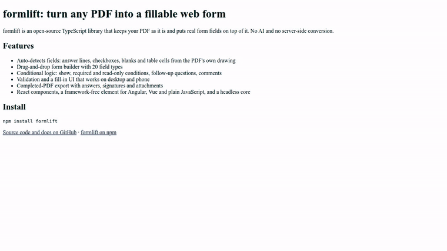
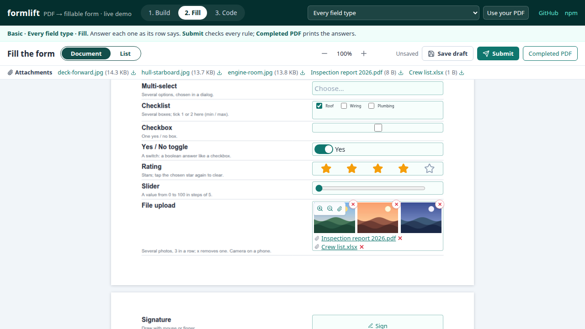

<div align="center">

# formlift

**Turn any PDF into a fillable web form, with no AI and no server-side conversion.**

Auto-detect fields · Drag-and-drop builder · Conditional logic · Validation · Fill-in UI · Completed PDF

For **React, Angular, Vue, Svelte or plain JS** · Runs in the browser, so PDFs never leave the user's device · MIT

Built for the forms your team already has as PDFs: inspection checklists, onboarding sheets, permits, audit reports.

```bash
npm i formlift
```

[](https://www.npmjs.com/package/formlift)
[](https://www.npmjs.com/package/formlift)
[](https://www.npmjs.com/package/formlift)
[](./LICENSE)
[](https://github.com/harendra-singh-negi/formlift/actions/workflows/ci.yml)

**[▶ Live demo](https://harendra-singh-negi.github.io/formlift/)** · [Quick start](#quick-start) · [API](#api-reference) · [Server](#server-side) · [Theming](#theming) · [Your own UI](#your-own-ui) · [FAQ](#faq)



</div>

---

## Why formlift?

Most organisations already have their forms as PDFs: inspection checklists, onboarding sheets, permits, audit
reports. Rebuilding each one in a form tool takes days and loses the original layout.

**formlift keeps the PDF as it is** and puts real form fields on top of it:

1. **Upload** a PDF. formlift reads the page drawing and **suggests fields** for dotted lines, underlines,
   checkboxes, `____` blanks and empty table cells.
2. **Adjust** them in the builder: rename, retype, move, add rules and conditions. formlift
   [learns from what you save](#auto-detect-that-learns), so the next form needs fewer changes.
3. **Publish.** People fill the form on the original page, on desktop or phone.
4. **Export** a completed PDF with the answers, signatures and attachments.

The original file is never modified. The whole form is plain JSON that you store wherever you like.

## How it compares

| | formlift | pdf-lib / pdf.js | Commercial PDF SDKs | Online form builders |
| --- | --- | --- | --- | --- |
| Keeps the original PDF layout | ✅ | ✅ | ✅ | ❌ rebuilt from scratch |
| Suggests fields automatically | ✅ no AI, runs locally | ❌ | varies, often paid add-on | ❌ |
| Drag-and-drop builder UI | ✅ | ❌ you build it | ✅ | ✅ |
| Conditional logic & validation | ✅ same code client + server | ❌ | limited | ✅ |
| Fill on phones (reflowed list view) | ✅ | ❌ | varies | ✅ |
| Completed PDF output | ✅ | ✅ low-level | ✅ | export varies |
| Your data stays in your app | ✅ | ✅ | ✅ | ❌ hosted by vendor |
| Price | Free, MIT | Free, MIT | Paid licence | Subscription |

Use **pdf-lib** if you only need to fill an existing AcroForm in code. Use **formlift** when people need to turn
ordinary PDFs into forms, fill them, and get a PDF back.

## Live demo

**[Try it in your browser →](https://harendra-singh-negi.github.io/formlift/)**

The demo runs the same components you install from npm. Pick what to see:

- **Basic**: *Every field type* (all 20, each next to what it is for), or a real *Form* and a *Form with a table*.
- **Advanced**: *Form logic*: groups of boxes, show / required / read-only conditions, follow-up dialogs,
  comments, and `onFieldChange` (your own code next to the editor's settings).

Each tour row says how to try it. Then:

1. **Build**: open a sample PDF or upload your own, review the suggested fields and edit them. Save, then press
   **Start over**: auto-detect brings your changes back.
2. **Fill**: answer the form on the page or in the list view, then download the completed PDF.
3. **Code**: see the exact JSON your app receives from `onSave` and the code that wires it up.

Nothing is uploaded. Your PDF and answers stay in your browser. To run the demo locally, use `npm run dev`.

## Features

| | |
| --- | --- |
| 🔍 **Auto-detect** | A fillable PDF (made in Acrobat, Word…) gives its own fields as they are: place, type, options, required, max length, named by the text beside them. On other pages, answer lines, checkboxes, typed blanks, table cells and boxes named above or beside them come from the PDF's own vector drawing. Sizes are measured relative to the text, so it works at any font size, scale or orientation. |
| 🧠 **Learns from your corrections** | Each save teaches auto-detect. A page you set up comes back the way you saved it, conditions included (in the next revision of the form, in any form that has the same page, even a scanned one). What you change about a label applies to that label in every form, and a field you draw by hand next to the same text twice is drawn there in every form. It also learns patterns that carry over to forms it has never seen: boxes like the ones you kept are suggested (answers printed as "Yes/No/NA" included), boxes like the ones you deleted are not, typed and grouped as you did. The editor shows what it learnt, and anything can be forgotten. No AI service: the lessons are plain JSON that you store. [How it works](#auto-detect-that-learns) |
| 🧱 **Builder** | 20 field types (text, date & time, currency, multi-select, checklist, rating, slider, toggle, signature, file…), drag/resize/snap-to-grid, undo/redo, keyboard shortcuts, fill order, page reorder/insert/delete. Copy a field (<kbd>Ctrl</kbd>+<kbd>C</kbd>) and paste it anywhere (<kbd>Ctrl</kbd>+<kbd>V</kbd>): it is named after what the PDF says there ("Gloves – Remarks" in a table cell), key included. [Copy and paste](#copy-and-paste-fields) |
| ✏️ **Layout editing** | Add text, boxes and lines, or click any line of the original text to replace it, all without touching the file |
| 🔀 **Conditional logic** | `visibleWhen` / `requiredWhen` / `readOnlyWhen` with nested AND/OR groups and 10 operators. Circular rules are rejected. |
| ☑️ **Groups, rows, follow-ups, comments** | Boxes that allow exactly one or several ticks, table rows people can add more of (**+ Add row**), follow-up dialogs ("No" → ask why), 💬 comments per field, and an `onFieldChange` hook for your own logic. [Guide](#guide-groups-follow-ups-comments-and-your-own-logic) |
| ✅ **Validation** | Required, length, min/max, regex, email, phone, date and options. The **same code** runs in the browser and on your server. |
| 📱 **Filler** | Fields stay pinned to the page at every zoom. The list view is the whole PDF reflowed for any screen (its text with bold, colours and highlights, its tables, its pictures) with the answers in place, plus search and filters. A long answer grows its box and pushes the rest of the page down; when that runs past the page, it breaks onto the next one right there as you type, with a margin above and below the break, exactly as it will print ([Long answers](#long-answers-grow-their-box)). Text fields wrap too once the answer is longer than the box. **+ Add row** under a repeatable table row adds a copy of the row, and the page moves down for it. Includes autosave, signatures and file uploads. |
| 📄 **Completed PDF** | Answers, signature images and embedded attachments in a new PDF. A fillable original's own fields are printed as they look and removed, so no empty field covers an answer. A long answer is printed in full: its box grows, what is below moves down, onto added pages with a half-inch margin at each break and no line cut in two. Added table rows print as rows of the table. Runs in Node, Bun, Deno, workers or the browser. |
| 🎨 **Isolated styling** | All CSS is scoped to `.fl-root` with no global reset, so it never clashes with your app (Tailwind included). Theme it with CSS variables. |
| 🧩 **Headless core** | Zero-dependency core you can use with any framework, or with none |
| 🟦 **TypeScript** | Written in TypeScript. Ships ESM, CommonJS and full type definitions. |

<div align="center">

</div>

## Packages

One install, four entry points. Import only what you use:

| Entry | Contents | Needs |
| --- | --- | --- |
| `formlift` | Types, validation, conditions, auto-detect, helpers | – |
| `formlift/react` | `<FormEditor>`, `<FormFiller>`, `<PdfPages>`, `setPdfWorker` | `react`, `react-dom` |
| `formlift/server` | `completedPdf()` | `pdf-lib` |
| `formlift/element` | `mountEditor()`, `mountFiller()` for Angular, Vue, Svelte or plain JS | – (React is bundled in) |
| `formlift/style.css` | Styles for the React components | – |

## Installation

```bash
npm install formlift
# or
pnpm add formlift
# or
yarn add formlift
```

Or install straight from GitHub (it builds on install), from a release tag or from a branch:

```bash
npm install github:harendra-singh-negi/formlift#v0.1.0
npm install github:harendra-singh-negi/formlift          # latest main
```

pdf.js (`pdfjs-dist` 5.x or 6.x) is a peer dependency: npm 7+ and pnpm install it for you, and an app that already has
it shares that one copy (no second pdf.js, no worker version mismatch). Yarn 1 or an older npm: `npm install pdfjs-dist`.
Add only what your app does not have yet:

```bash
npm install react react-dom   # formlift/react, if your app is not already a React app
npm install pdf-lib           # formlift/server (completed PDF)
```

**Works in** Chrome / Edge 111+, Firefox 128+ and Safari 16.4+ (the CSS baseline of Tailwind v4, which builds the styles), React 18 and 19, Next.js App Router
(`formlift/react` is marked `"use client"`; `formlift/server` stays server-safe) and TypeScript with any
`moduleResolution` (`bundler`, `node16`, `nodenext`). Long documents stay light: only the pages near the screen are
drawn and carry their fields, so a 300-page form with thousands of fields scrolls like a short one.

Angular, Vue, Svelte or plain JS: use `formlift/element`, which needs nothing else.

**Requirements:** React 18 or 19 (only for `formlift/react`) · Node 18+ · browsers with CSS `@scope` support (Chrome/Edge 118+,
Safari 17.4+, Firefox 128+).

## Quick start

### 1. Configure pdf.js (once, at app start)

```ts
import { setPdfWorker } from 'formlift/react'
import 'formlift/style.css'

// Vite
import workerUrl from 'pdfjs-dist/legacy/build/pdf.worker.min.mjs?url'
setPdfWorker(workerUrl)

// webpack 5 / Next.js
// setPdfWorker(new URL('pdfjs-dist/legacy/build/pdf.worker.min.mjs', import.meta.url).toString())
```

> If you skip this step, the worker is loaded from unpkg.com for the installed pdfjs-dist version. That works,
> but it needs internet access and is blocked by a strict CSP.
>
> Use the **legacy** worker, as above. formlift loads pdf.js's legacy build, which carries polyfills for browsers
> without `Promise.try` (before Chrome 128, Firefox 134, Safari 18.2, e.g. Firefox ESR 128). The modern worker
> stops on those browsers partway through a document ("Promise.try is not a function"); formlift warns in the
> console when it sees that pairing. Angular: copy `node_modules/pdfjs-dist/legacy/build/pdf.worker.min.mjs` as an
> asset and pass its URL.

### 2. Build a form (admin)

```tsx
import { FormEditor, type FormDoc } from 'formlift/react'

export function FormBuilder({ pdfUrl, saved }: { pdfUrl: string; saved?: FormDoc }) {
  return (
    <div style={{ height: '100vh' }}>
      <FormEditor
        pdf={pdfUrl}
        initialValue={saved}
        title="Staff onboarding"
        onSave={(doc) =>
          fetch('/api/forms/42', {
            method: 'PUT',
            headers: { 'Content-Type': 'application/json' },
            body: JSON.stringify(doc),
          })
        }
      />
    </div>
  )
}
```

### 3. Fill it (users)

```tsx
import { FormFiller, type FormDoc } from 'formlift/react'

export function FillForm({ pdfUrl, form }: { pdfUrl: string; form: FormDoc }) {
  return (
    <div style={{ height: '100vh' }}>
      <FormFiller
        pdf={pdfUrl}
        fields={form.fields}
        layout={form.layout}
        onSave={async (answers, { submit }) => {
          const res = await fetch('/api/forms/42/answers', {
            method: 'POST',
            headers: { 'Content-Type': 'application/json' },
            body: JSON.stringify({ answers, submit }),
          })
          // Throw { errors: { fieldKey: message } } and the messages appear at the fields
          if (!res.ok) throw await res.json()
        }}
        onSubmitted={() => alert('Thank you!')}
      />
    </div>
  )
}
```

That's it. Both components fill the height of their container.

### Angular, Vue, Svelte or plain JS

`formlift/element` has React, pdf.js (with its worker) and its CSS inside. **No setup in your app**: no
stylesheet in `angular.json`, no worker asset to copy, no `setPdfWorker`. Install `formlift` and mount:

```ts
import { mountEditor, mountFiller } from 'formlift/element'

// Builder: the form is plain JSON, store it wherever you like
const editor = mountEditor(element, {
  pdf: '/files/form.pdf',
  initialValue: saved,              // { fields, layout } from your store
  onSave: (doc) => api.saveForm(doc),
  limits: { maxFields: 20000 },
})
editor.update({ stickyToolbar: false }) // change options later
editor.unmount()                        // e.g. in ngOnDestroy

// Fill-in: answers come out as JSON on every change, no server needed
const filler = mountFiller(element, {
  pdf: '/files/form.pdf',
  fields: saved.fields,
  layout: saved.layout,
  onChange: (answers) => console.log(answers), // { fieldKey: value }
})
```

Options are the same as the `<FormEditor>` / `<FormFiller>` props below, except the ones that take React content
(`toolbar`, `banner`, `tabs`, `components`); `title` is plain text. `mountEditor` also returns `save()`, `dirty` and
`value`. Give the element a height: the components fill it.

- **CSS** is added to the page (or the shadow root) on the first mount, once. If your app already loads
  `formlift/style.css`, formlift sees it and adds nothing. Your own CSS still overrides it (theme variables etc.).
- **pdf.js** is a lazy chunk, loaded with the first document, and runs its worker from a `blob:` URL. With a strict
  Content-Security-Policy, allow `worker-src blob:`, or serve the worker yourself:
  `setPdfWorker('/assets/pdf.worker.min.mjs')` (copy `pdfjs-dist/legacy/build/pdf.worker.min.mjs`, same version
  as formlift's `pdfjs-dist`).
- React apps use `formlift/react` instead: there your bundler handles the stylesheet import and the worker URL
  ([Configure pdf.js](#1-configure-pdfjs-once-at-app-start)).

## Guide: groups, follow-ups, comments and your own logic

From no code to full control. Pick the first one that does the job:

| You want… | Use | Code needed |
| --- | --- | --- |
| Separate boxes where only one (or 2–3, or all) may be ticked | [Groups of boxes](#groups-of-boxes) | none: set in the editor |
| More fields on the page when an answer is given | [`visibleWhen`](#data-model) | none: Conditions in the editor |
| A table where people add as many rows as they need | [Repeatable table rows](#repeatable-table-rows) | none: set in the editor |
| The same field again elsewhere, named after its new spot | [Copy and paste](#copy-and-paste-fields) | none: <kbd>Ctrl</kbd>+<kbd>C</kbd> / <kbd>Ctrl</kbd>+<kbd>V</kbd> in the editor |
| A dialog asking more questions ("No" → why, by when) | [Follow-up dialogs](#follow-up-dialogs) | none: set in the editor |
| A 💬 per field where people leave remarks | [Comments](#comments) | store `info.comments` |
| Anything else: fill other fields, call your API, your own dialog | [`onFieldChange`](#your-own-logic-onfieldchange) | a function |
| Your own icon or button next to a field (React) | [`renderFieldExtras`](#your-own-logic-onfieldchange) | a component |

Everything is part of the form JSON (`FieldDef`), checked by `validateFields`, and enforced by `validateAnswers` in the
browser **and on your server**.

### Groups of boxes

A PDF often has "☐ Yes ☐ No ☐ N/A" as separate boxes. Put them in a group:

- **Editor:** select a box → *Group of boxes* → **New group…**, then select each other box → pick the same group.
  Choose *Exactly one* or *Several*, tick *An answer is required*, and for *Several* set *Choose at least / at most*.
- **JSON:** every member carries the same `group`:

```ts
{ key: 'cert_yes', type: 'checkbox', group: { id: 'cert', mode: 'single', required: true }, /* … */ }
{ key: 'cert_no',  type: 'checkbox', group: { id: 'cert', mode: 'single', required: true }, /* … */ }
// mode 'multiple': any number, with min / max: { id: 'hazards', mode: 'multiple', min: 1, max: 3 }
```

| mode | While filling | Checked on submit (browser + server) |
| --- | --- | --- |
| `single` | Ticking one unticks the others | Exactly one when `required`; never two |
| `multiple` | Free | At least `min` (1 when `required`), at most `max` |

The error shows at the group's first visible box. Members hidden by a condition don't count. Answers stay one boolean
per box. Groups work for `checkbox` and `toggle`. (`radio` is one-of-many already; `checklist` / `multiselect` have
`min` / `max` built in.) Your own UI applies the rule with `applyAnswer(fields, answers, field, value)`.

### Repeatable table rows

A table with "add as many rows as you need": the person clicks **+ Add row** under the row and gets a copy of it
(its lines and fields), and the rest of the page moves down, on screen and in the completed PDF.

- **Editor:** select each field of one table row → *Repeatable row* → **New repeatable row…** for the first, then the
  same row for the others. *Most rows* caps it (empty = no limit).
- **JSON:** every field of the row carries the same `repeat`:

```ts
{ key: 'task', type: 'text', repeat: { id: 'tasks', max: 10 }, /* … */ }
{ key: 'due',  type: 'date', repeat: { id: 'tasks', max: 10 }, /* … */ }
```

Row 2, 3… of a field are the answers `task__2`, `task__3`…, and how many rows there are is the answer
`tasks__rows` (`'3'`; missing = 1). Every row is checked like the first (a required field is required in every row),
and `validateAnswers`, `cleanAnswers`, `fieldStates` and `completedPdf` take the form's own fields: they add the
rows the answers ask for themselves (`expandRows(fields, answers)` gives you that list). An ✕ next to an added row
takes it out and moves the rows under it up (`removeRow(fields, answers, id, k)`).

The copied band is the row's fields plus 2 points under them (the row's bottom line), across the whole page width, so
whatever else is in that band (an item name in the first column) is copied too.

### Copy and paste fields

Set up one field the way you want it (type, size, validation, settings), then reuse it:

1. Click the field and press <kbd>Ctrl</kbd>+<kbd>C</kbd>.
2. Point at the spot on the PDF where it should go and press <kbd>Ctrl</kbd>+<kbd>V</kbd>. The copy lands there (the
   pointer is its top-left corner).
3. It is named after what the PDF says there, and its key follows the name: what auto-detect would call a box at
   that spot (a table cell: "Gloves – Remarks"), else the words on its left on the same line ("Name:"), else the
   words right above it. When nothing names it, it keeps the copied label.

The copy keeps everything else of the field, but not its group of boxes or its repeatable row (it is somewhere
else now). Paste as often as you like; one <kbd>Ctrl</kbd>+<kbd>Z</kbd> undoes one paste. <kbd>Ctrl</kbd>+<kbd>D</kbd>
still duplicates right under the field with the same label. In your own UI: `labelAt(pdf, OPS, source, page,
position)` gives the name for a spot (`nameAt(position, proposed, lines)` when you already read the page), and
`useFormEditor` has `copySelected()` and `paste()`.

### Field keys

A field's key is the name its answer is stored under. It is made from the label (`Site Name` → `site_name_1`) and
follows the label until you type your own in the **Key** box. A typed key stays when the label changes. It must start
with a letter, use letters, digits or `_`, and be unique in the form: a key that is already used shows "This key
already exists" right under the box and is not saved. Conditions and follow-ups that use a key follow it when it
changes. In code: `keyProblem(key, id, fields)` says why a key cannot be used (`'empty' | 'invalid' | 'taken'`), or
`null`.

### Photos and attachments

A file field takes any file. On a phone or tablet it offers two buttons: **Attach** (choose a file) and **Camera**
(take a photo). Everywhere the file shows under its original name.

In the editor, a file field's **Attachment** section has:

- **Files people can attach**: one file (a new one replaces it) or several (each added, each with a ✕ to take it
  off; the file picker lets people choose many at once). Field setting: `multiple`. The answer is then a JSON list
  of file ids, like a multiselect's: `fileIds(answer)` reads either shape. `useFormFiller` has `filesOf(answer)` and
  `removeFile(field, id)`. In the completed PDF every file is attached.
- **Photos in the box (and the PDF)**: PNG / JPEG answers show as photos right in the field's box while filling,
  and are drawn the same way in the completed PDF: with several files, 1 to 6 side by side in a row (a row per
  box height), each whole in its cell, with a ✕ to take it off. Other files (PDF, Word, WebP…) take a cell too, as
  a tile with their name. Unset, the names show. Field setting: `photosPerRow`.

Every file is also inside the completed PDF (the viewer's attachments panel; a click on its cell opens it), and an
**Attached files** page at the end lists them by field, for viewers without that panel (Chrome's).

One click to download: PDF viewers open a file kept inside a PDF on a double click (Firefox, Acrobat) or not at all
(Chrome). Pass where your app serves each file and its cell becomes a link, opened with one click in any viewer:

```ts
completedPdf(pdf, fields, answers, files, layout, { fileUrl: (id) => `https://your.app/files/${id}` })
```

- **Name in the list view**: one line, cut short (default), or as many lines as the name needs. Field setting:
  `listRows: 'single' | 'multiple'`.

With several files the box grows like a long answer: a row per box height (photosPerRow photos to a row; names
one per row), and what is below moves down, onto the next page when needed. On screen and in the
completed PDF alike. `fileRows(field, answer, height)` gives the rows.

The list view's **Photos / attachments** filter (`attachmentFilter()`) shows the questions with a file attached or
still missing one.

### Long answers grow their box

Nothing to set up. While filling, a text area, checklist or text field whose answer does not fit grows: the box gets
taller (a text field wraps onto more lines) and everything below it on the page moves down, table lines included.
When the page runs over, it continues on the next one with a half-inch margin above and below the break, and never
through a line of the answer. The filler shows this live as you type, and `completedPdf` prints the same (the PDF
can get more pages than the original). Short answers print exactly as before.

Where the page grows, it is cut on a line with no text beside the growing box, so the text next to it moves down
whole (not cut in two or smeared). The filler reads the page's text for this once something grows. For the
completed PDF, pass the text: `completedPdf(pdf, fields, answers, files, layout, { textLines: await
pdfTextLines(pdf) })` (`pdfTextLines` from `formlift/react`, page → lines). Without it the cut is at the box's
bottom as before.

### Follow-up dialogs

"If the answer is **No**, ask for the reason and a due date":

- **Editor:** select the field → *Follow-up questions* → **Add a question** (pick a type; repeat for more). Set
  *Ask when* (e.g. *this field* · *equals* · `No`) and optionally a *Dialog heading*. Click a question in the list
  to edit its label, rules and so on.
- **JSON:**

```ts
{
  key: 'cert_ok', type: 'radio', options: ['Yes', 'No'], /* … */
  followUp: {
    when: { logic: 'and', rules: [{ fieldKey: 'cert_ok', op: 'equals', value: 'No' }] },
    title: 'Why not?',
    fields: ['cert_reason', 'cert_due'],
  },
}
{ key: 'cert_reason', type: 'textarea', dialogOnly: true, required: true, /* … */ }
{ key: 'cert_due',    type: 'date',     dialogOnly: true, /* … */ }
```

- **While filling:** the dialog opens when the person's change makes `when` true. A ⊕ badge next to the field shows
  how many follow-up answers there are and reopens the dialog. It turns red when one of them has an error.
- **Answers:** ordinary answers under their own keys (`cert_reason`, `cert_due`), with their own validation. They count
  only while the follow-up is open: `required` applies then, and they are skipped otherwise. `fieldStates` and
  `validateAnswers` handle this, so the server agrees.
- **Completed PDF:** dialog-only fields have no box on the page. They are printed on an *Additional answers* page at the
  end, under the field that asked them (e.g. "Certificates OK (page 3)").
- Deleting a field removes its follow-up questions; renaming one keeps the follow-up pointing at it.

### Comments

- **Editor:** tick *Allow comments* on a field (JSON: `comments: true`).
- **While filling:** a 💬 next to the field shows the count. Clicking it opens the comments: each with author and time,
  plus a box to add one. Deleting is possible unless the filler is `readOnly`.
- **Storing:** comments are kept apart from the answers (a conversation, not an answer):

```tsx
<FormFiller
  fields={form.fields}
  initialAnswers={draft.answers}
  initialComments={draft.comments}      // Comments: { [fieldKey]: { id, text, by?, at }[] }
  commentAuthor={currentUser.name}      // stored as `by`
  onSave={(answers, { submit, comments }) => api.save({ answers, comments, submit })}
  onCommentsChange={(comments) => {/* optional: live */}}
/>
```

- **Server:** `cleanComments(form.fields, req.body.comments)` keeps only fields that allow comments and well-formed
  entries (at most `limits.maxComments` per field, default 200).
- **Completed PDF:** pass them to print a *Comments* page:
  `completedPdf(original, fields, answers, files, layout, { comments })`.

### Your own logic: `onFieldChange`

Runs after the person changes a field (not after your own `setAnswer`), with the answers after the change:

```tsx
<FormFiller
  fields={form.fields}
  onFieldChange={(field, value, api) => {
    // fill another field
    if (field.key === 'site') api.setAnswer('permit', lookupPermit(String(value)))
    // ask dialog-only fields your way (they need no follow-up)
    if (field.key === 'incident' && value === true) api.openDialog(['incident_time', 'incident_place'], 'Incident details')
    // tell the person something
    if (field.key === 'expiry' && String(value) < today) api.notify('This certificate has expired')
  }}
  renderFieldExtras={(field, { answers }) =>        // React only: your icon / button next to a field
    field.key === 'permit' ? <a href={`https://registry.example/${answers.permit}`}>🔗</a> : null}
/>
```

`api` = `{ answers, setAnswer(key, value), openDialog(keys, title?), notify(message) }`. Answers set this way are
ordinary answers: saved, validated and printed like any other. Dialog-only fields not used by any follow-up are
always counted, so give them `visibleWhen` if they apply only sometimes.

**Angular / Vue / plain JS:** `onFieldChange`, comments and everything above work the same through
`mountFiller(el, { ... })`. `renderFieldExtras` is React-only.

## Auto-detect that learns

Auto-detect finds fields in the PDF's drawing. Every time an admin saves, formlift also writes down what they
changed: a **lesson**. Pass the lessons back to the editor and the next detection starts from what your admins
already did, so every form needs fewer corrections than the one before. Use it as much as you can. It gets better
with every form you save.

It learns in two ways. It **remembers**: a page set up before comes back as it was saved, and a label changed once
is changed in every form. And it **learns patterns that carry over to forms it has never seen**: it knows a box by
what is around it (a blank cell under a "Comments" header, answers printed in place of boxes, a label ending in
":" before it), so what admins did with boxes in one form applies to boxes like them in any other form, whatever
their words. See [Forms it has never seen](#forms-it-has-never-seen).

There is no AI service, and nothing is sent anywhere. A lesson is plain JSON that **your app** stores, the same
way it stores the forms. Keep one set of lessons for the whole organisation, and every admin's work helps all the
others.

### What it learns

| When the admin… | the next detection… |
| --- | --- |
| sets up a page: deletes, adds, moves, renames or retypes fields, groups boxes, adds conditions and follow-up questions | **puts that page back the way it was saved**, conditions and follow-ups included. This happens in the next revision of the form, and in any other form that has the same page (a cover page, say). Each field moves with the line of text next to it, so it still fits when the text has moved. What auto-detect finds on the page now and did not find then (a newer formlift, say) is still suggested; what the admin removed there is not. |
| changes the settings of a suggestion: type, label, options, required, placeholder, help text, rules… | **gives every suggestion with that label the same settings, in every form.** A "Date of joining" changed to a Date once comes as a Date from then on. |
| deletes a suggestion in two forms in a row | **stops suggesting that label**, until an admin keeps it in a form again or adds a field with that label by hand. |
| draws a field by hand next to the same line of text twice (on two pages of a long form, or in two forms), where auto-detect found nothing (after "Remarks:", say) | **draws that field next to that line in every form**, where there is room for it. |
| keeps, deletes or draws boxes on a page, changes their type or required, or groups a row of Y / N / NA boxes | **does the same with boxes like those, in any form**, also in a form auto-detect has never seen. Answers printed in place of boxes ("Yes/No/NA"), light filled input boxes, blank cells and the space after a label are suggested once admins kept boxes like them; small squares used as bullets are left out once admins deleted them. |
| draws fields where auto-detect proposed nothing at all, in the same place next to their labels (the blank space under "Describe the work carried out:", say) | **tries that place next to every label like those, in any form**, and suggests it where admins drew there before under labels like it: under "Give details of the incident:" in a form it has never seen. |

**An example.** Your forms all ask for a **Date of joining**.

1. **First form.** Auto-detect finds the blank next to "Date of joining:" and suggests a plain **Text** field. The
   admin changes it to **Date**, ticks **Required** and saves.
2. **Every form after that.** Auto-detect suggests "Date of joining" as a required **Date** field straight away.
   Nobody has to fix it again: not this admin, and not anyone else in your company who shares the lessons.
3. **Next revision of the first form.** The page with "Date of joining" comes back exactly as the admin left it,
   with all its other fields too, even if a new line of text above it pushed everything down a little.

The person filling the form sees nothing of this. They just get the right field: a date picker that must be
filled in.

A field that auto-detect made from a lesson says so in its properties. After auto-detect, the editor also says how
many fields came from pages set up before, and how many follow what you taught it.

- **How a page is recognised:** by the lines of text that appear only on that page of its document. Mostly the
  same text must be in the same place. A text that moved as a block still counts, a different layout does not.
  When the page's boxes and lines changed (the same text in another form), it is not taken for the page set up
  before either. A page with hardly any text of its own (a scan) is recognised by its picture: the same scan, in
  this file or in any other. A page saved without fields is not remembered: it keeps getting suggestions.
- **A page set up before still gets new suggestions:** the fields the admin kept, changed or added come back as
  saved, the places where they removed or moved a field get nothing, and what auto-detect finds anywhere else on the
  page comes as a dashed suggestion, as on a new page. Fields drawn by hand in other forms are not added to it: the
  admin drew on this page what they wanted.
- **Long forms:** only the pages an admin changed teach auto-detect, because a page left as it was may not have
  been looked at yet. Set up the first page or two of a long form (a 1001-page form repeats the same page, say),
  save, and **Auto-detect** again: the other pages follow what you did. (Auto-detect again remakes only the
  suggestions of this session that nobody touched; fields an admin changed or saved before stay as they are.)
- **Not learnt:** a setting that the admin set differently on suggestions with the same label, on the pages they
  changed. Conditions and follow-ups come back with the page they were set up on, not on other forms, because they
  point at fields of that form. A field drawn by hand once comes back on its own page; drawn next to the same line
  twice, it is drawn there in every form; drawn at the same place under or after labels like each other, it is
  suggested at that place next to labels like them (see [Forms it has never seen](#forms-it-has-never-seen)).
- **What a lesson stores:** hashes of some lines of each page it remembers (a small picture for a scan), the labels
  that the admin changed or deleted (kept labels only as hashes), the fields as the admin saved them, the boxes
  of fields they removed, the cues of the boxes on the pages they changed (structure as it is, `k=cell`,
  `h1`; words only as hashes) with what they did with each, the places of fields drawn by hand (numbers), and how
  many corrections the save needed. It stores no answers and no other text from the page.

### Forms it has never seen

Remembering helps with the forms you already set up. Patterns help with the next, different one.

- **How it sees a box.** Every box auto-detect proposes on a page (what its rules suggest, and boxes it suggests
  only once taught: answers printed in a cell, light filled boxes, blank cells, the space after a short label) gets
  its cues: what proposed it, its size in letters and lines of that page's own text, whether it is in a table cell
  or on an answer line or framed or filled, what is printed in it, the label before it, over it or after it, its
  column's header, and how many boxes like it share its row. A field the admin draws gets the same cues.
- **What a save teaches.** On the pages the admin changed: each box they kept or drew is a field, each they deleted
  or left empty is not, and each field's type, required and grouping is what they gave it.
- **What detection does with it.** It trains a small model from all lessons, in the browser, in a few milliseconds
  (logistic regression for "is this a field", starting from how sure the rules are; counts per cue for the type,
  required and grouping). Then it suggests boxes like those admins kept, leaves out boxes like those they deleted,
  and gives a box the type admins gave boxes with the same words around them, measured against the type auto-detect
  gave it: a "Mobile number" stays a phone even where "Permit number" boxes were kept as text. A row of boxes is
  grouped (one answer) where admins grouped rows like it. The field's properties say why ("column “comments”",
  "answers printed in it").
- **It needs evidence.** A box the rules do not suggest, or one they are sure of, changes only after admins did
  the same with several boxes like it (one save with many alike, or a few saves). What it was not shown, it leaves
  as it was.
- **Measured.** `npm run eval` sets up 8 synthetic forms one after another, then scores 6 forms that share no
  label, question or item with them: 96 corrections without lessons, 0 with them, and nothing that was right made
  wrong. With questions answered in blank space under them (nothing drawn there), 3 forms set up teach 4 forms
  never seen: 16 fields to draw by hand without lessons, 3 with them. `npm run eval:real` scores your own forms the
  same way (see [CONTRIBUTING](./CONTRIBUTING.md)). On a real bank checklist whose answers are printed "Yes/No" in a column, an admin who set up one page got a
  dropdown in every Yes/No cell of the other pages.
- **Places where admins draw.** A field drawn where auto-detect proposed nothing is learnt by its place next to
  its label: under it or after it on its row, how far, how wide and how tall, in letters and lines of that page,
  and the shape of the label (it ends with ":", it is short, it starts its row). Detection tries each place next to
  every label of that shape where there is room: not where a field or a rule's box already answers the label, not
  under a table from a label in its cell, not in the page's bottom margin. Those boxes get cues like any other, so
  the same model suggests the ones like where admins drew and leaves out the others; the labels where admins drew
  nothing teach it where not to.
- **Not learnt:** what admins never did. It learns from your admins, not from the world: "DOB" becomes a date once
  an admin made a "DOB" box a date ("Valid till" and "Expiry date" share no word, so one does not teach the other),
  and a place is tried only next to labels shaped like the ones admins drew at. Conditions and follow-ups come back
  with their page, not in other forms.

### See and forget what it learnt

The editor's **Learnt** tab lists what auto-detect learnt: the labels it changes or leaves out, the fields it draws
by hand, how many pages it puts back, and how many boxes taught it patterns. It also shows how many corrections each
save needed (suggestions deleted or changed, fields drawn by hand), oldest first: the bars get shorter as it learns
(`learnt().corrections`, from each lesson's `score`). Each has **Forget**, and **Forget
everything** starts from scratch. A
field that auto-detect made from a lesson has **Forget this** in its properties: forget the page it came from, or
what was learnt about its label.

Forgetting is a lesson too: `onLesson` gets it and you store it like any other, so your server needs no delete.
What was learnt before it no longer counts, and what admins teach after it counts again. The tab shows only where
learning is on (`onLesson`); `hide={['learntTab']}` leaves it out.

### Turn it on

Two props. `onLesson` receives a lesson after each save that taught something, or that had suggestions (it then
holds at least how many corrections they needed). `lessons` is all the lessons you
have stored:

```tsx
<FormEditor
  pdf={pdfUrl}
  onSave={saveForm}
  lessons={lessons}                              // every lesson you stored: all forms, all admins
  onLesson={(lesson) => api.saveLesson(lesson)}  // store it, replacing the one with the same id
/>
```

- **Store each lesson by its `id`.** Each editing session has one id. When the same session saves again, it sends
  a lesson with the same id that covers everything the session did, and that lesson replaces the old one.
  `addLesson(lessons, lesson)` does this for an array.
- **Load the lessons before the editor opens.** Auto-detect runs as soon as the PDF is open.
- **Angular / Vue / plain JS:** the same two options, in `mountEditor(el, { lessons, onLesson })`. A custom editor
  on `useFormEditor` takes the same two options, and gets `learnt` and `forget` for its own Learnt view. Without
  the editor, `lessonFor(pdf, pages, session, { OPS, lessons })` makes a lesson (`lessons`: those the session's
  detection used, so what the admin did with the places they made it try is learnt too) and
  `detectDocument(…, lessons)` uses lessons.

### Where to keep lessons

The more forms feed into the same lessons, the better detection gets. So keep **one shared set on your server**.

**1. Your API and database (recommended).** One row per lesson:

```sql
CREATE TABLE formlift_lessons (
  id         VARCHAR(100) PRIMARY KEY,
  lesson     JSON NOT NULL,                       -- JSONB in PostgreSQL
  updated_at TIMESTAMP NOT NULL DEFAULT CURRENT_TIMESTAMP
);
```

```ts
import compression from 'compression'
import express from 'express'
import { validateLesson } from 'formlift'

const app = express()
  .use(compression()) // lessons are JSON: gzip makes them 4 to 8 times smaller
  .use(express.json({ limit: '5mb' })) // a lesson for a 300-page form is about 0.5 MB at most

// Every lesson, for the editor
app.get('/api/formlift/lessons', async (req, res) => {
  const { rows } = await db.query('SELECT lesson FROM formlift_lessons ORDER BY updated_at')
  res.json(rows.map((r) => r.lesson))
})

// One lesson from onLesson: check it, then add it or replace the one with its id
app.put('/api/formlift/lessons/:id', requireAdmin, async (req, res) => {
  const problems = validateLesson(req.body)
  if (problems.length || req.body.id !== req.params.id) return res.status(400).json({ problems })
  await db.query(
    `INSERT INTO formlift_lessons (id, lesson) VALUES ($1, $2)
     ON CONFLICT (id) DO UPDATE SET lesson = $2, updated_at = CURRENT_TIMESTAMP`,
    [req.params.id, req.body],
  )
  res.sendStatus(204)
})
```

```tsx
import { addLesson, type Lesson } from 'formlift'

const [lessons, setLessons] = useState<Lesson[] | null>(null)
useEffect(() => void api.get('/api/formlift/lessons').then(setLessons), [])

// the editor opens once the lessons are in
{lessons && (
  <FormEditor
    pdf={pdfUrl}
    onSave={saveForm}
    lessons={lessons}
    onLesson={async (lesson) => {
      await api.put(`/api/formlift/lessons/${lesson.id}`, lesson)
      setLessons((all) => addLesson(all ?? [], lesson))
    }}
  />
)}
```

**2. A JSON file on your server (no database).** One file holds every lesson. The browser code stays the same as
above. On the server, write one lesson at a time, so that two admins who save together don't overwrite each
other's lessons. Write to a temporary file first, so that a crash never leaves half a file:

```ts
import fs from 'node:fs/promises'
import { addLesson, validateLesson, type Lesson } from 'formlift'

const FILE = '/var/lib/your-app/formlift-lessons.json' // outside the web root, included in your backups
const readAll = async (): Promise<Lesson[]> => JSON.parse(await fs.readFile(FILE, 'utf8').catch(() => '[]'))
let writing = Promise.resolve()

app.get('/api/formlift/lessons', async (req, res) => res.json(await readAll()))

app.put('/api/formlift/lessons/:id', requireAdmin, (req, res) => {
  const problems = validateLesson(req.body)
  if (problems.length || req.body.id !== req.params.id) return res.status(400).json({ problems })
  const done = writing.then(async () => {
    const all = addLesson(await readAll(), req.body) // replaces the one with this id; keeps the newest 1000
    await fs.writeFile(FILE + '.tmp', JSON.stringify(all))
    await fs.rename(FILE + '.tmp', FILE)
  })
  writing = done.catch(() => {}) // the next write waits for this one, even if it failed
  done.then(() => res.sendStatus(204), (e) => res.status(500).json({ error: String(e) }))
})
```

This works for one server process. If your app runs on several processes or servers, use a database.

**3. Only in the browser (to try it out).** Every browser then learns on its own, and `localStorage` holds
only a few MB. Use it to see learning work, and keep lessons on the server for real use:

```tsx
const KEY = 'formlift-lessons'
const [lessons, setLessons] = useState<Lesson[]>(() => JSON.parse(localStorage.getItem(KEY) ?? '[]'))

<FormEditor
  pdf={pdfUrl}
  onSave={saveForm}
  lessons={lessons}
  onLesson={(lesson) =>
    setLessons((list) => {
      let all = addLesson(list, lesson, 50)
      // localStorage is full: the oldest lessons make room
      for (;;)
        try {
          localStorage.setItem(KEY, JSON.stringify(all))
          return all
        } catch {
          if (all.length <= 1) return all
          all = all.slice(1)
        }
    })
  }
/>
```

### Good to know

- **Check lessons on the server.** A lesson comes from the browser, so run `validateLesson` before you store it.
  Detection also skips lessons that fail the check. Accept lessons only from people who may edit forms, because a
  lesson changes what auto-detect suggests to every admin.
- **Size.** A lesson holds only the pages the admin changed, so most are a few KB. A 309-page checklist with every
  page changed makes about 1.1 MB, about 0.2 MB gzipped (half of it what boxes taught); a 1001-page form with
  12 000 fields, all changed, about 2.3 MB (0.2 MB gzipped). `addLesson` keeps the newest 1000 lessons.
- **Forms over 5000 fields or 1000 pages** need higher `limits`: in the editor, in `validateFields` on your server,
  and in `validateLesson` (the same values everywhere).
- **Undo a lesson.** Forget it in the Learnt tab, or set the page up again the right way and save: a newer lesson
  always wins. **Forget everything** starts from scratch, and so does deleting the stored lessons.

## Server side

**Never trust the browser.** Run the same checks on your server with the core package:

```ts
import express from 'express'
import { cleanAnswers, cleanComments, validateAnswers, validateFields, validateLayout } from 'formlift'
import { completedPdf } from 'formlift/server'

const app = express().use(express.json({ limit: '5mb' }))

// Save a form definition
app.put('/api/forms/:id', async (req, res) => {
  const { fields, layout } = req.body
  const pageCount = await pagesOfUploadedPdf(req.params.id)
  const problems = [...validateFields(fields, pageCount), ...(layout ? validateLayout(layout, pageCount) : [])]
  if (problems.length) return res.status(400).json({ problems })
  await db.forms.update(req.params.id, { fields, layout })
  res.sendStatus(204)
})

// Save or submit answers
app.post('/api/forms/:id/answers', async (req, res) => {
  const form = await db.forms.get(req.params.id)
  const answers = cleanAnswers(form.fields, req.body.answers) // drops unknown keys, coerces types
  const comments = cleanComments(form.fields, req.body.comments) // only fields with comments: true
  if (req.body.submit) {
    const errors = validateAnswers(form.fields, answers) // {} = valid; hidden fields and closed follow-ups are skipped
    if (Object.keys(errors).length) return res.status(422).json({ errors })
  }
  await db.submissions.save(req.params.id, { answers, comments }, req.body.submit)
  res.sendStatus(204)
})

// Download the completed PDF
app.get('/api/submissions/:id/pdf', async (req, res) => {
  const { form, answers, comments, files } = await db.submissions.full(req.params.id)
  const pdf = await completedPdf(form.originalPdf, form.fields, answers, files, form.layout, { comments })
  res.type('application/pdf').send(Buffer.from(pdf))
})
```

`files` maps a file answer's id to `{ fileName, fileType, bytes }`. Signatures are drawn as images and
uploads are embedded as PDF attachments. Follow-up answers and comments go on pages at the end.

## API reference

### `<FormEditor>`

| Prop | Type | Default | Description |
| --- | --- | --- | --- |
| `pdf` | `PdfSource` | **required** | The PDF: a URL, `Blob`/`File`, `ArrayBuffer`, `Uint8Array`, or an (async) function that returns one |
| `onSave` | `(doc: FormDoc) => unknown` | **required** | Called on Save. Throw or reject to keep the changes marked unsaved. |
| `initialValue` | `FormDoc` | empty | The saved form. To load a different one, remount with a new `key`. |
| `onChange` | `(doc: FormDoc) => void` | – | Called on every change, including undo and redo |
| `autoDetect` | `boolean` | new forms only | Runs field detection when the PDF opens |
| `title` | `ReactNode` | – | Toolbar title |
| `onBack` | `() => void` | – | Shows a Back button |
| `toolbar` | `ReactNode` | – | Your buttons at the end of the toolbar, such as a workflow status or Publish |
| `banner` | `ReactNode` | – | A strip under the toolbar |
| `tabs` | `{ id, label, content }[]` | `[]` | Extra tabs in the side panel, such as History |
| `notify` | `(msg: string) => void` | no-op | Success messages: connect your toast system here |
| `onError` | `(err: unknown) => void` | `console.error` | Error messages |
| `className` | `string` | `'h-full'` | Classes on the root element |
| `ref` | `Ref<FormEditorHandle>` | – | `{ save(), dirty, value }`, for example to save before a workflow step |
| `hide` | `EditorPart[]` | `[]` | Parts to leave out: `back`, `title`, `status`, `undo`, `snap`, `zoom`, `editText`, `autoDetect`, `preview`, `save`, `tools`, `fieldTools`, `layoutTools`, `panel`, `propertiesTab`, `fieldsTab`, `pagesTab`, `learntTab`, `problems` |
| `fieldTypes` | `FieldType[]` | all | Field types that can be added |
| `elementTools` | `ElementTool[]` | all | Layout tools that can be added (`[]` = none) |
| `components` | `FormliftComponents` | – | Replacement UI components and answer controls ([Your own UI](#your-own-ui)) |
| `labels` | `Partial<Labels>` | English | Your own text for every button, heading and message (any language) ([Labels](#labels-text-and-language)) |
| `keyboard` | `boolean` | `true` | Keyboard shortcuts |
| `warnUnsaved` | `boolean` | `true` | Browser warning when leaving with unsaved changes |
| `onDetected` | `(found: FieldDef[]) => void` | – | Called with the fields auto-detect suggested |
| `lessons` | `Lesson[]` | – | What earlier saves taught auto-detect, from all your forms and admins ([Auto-detect that learns](#auto-detect-that-learns)) |
| `onLesson` | `(lesson: Lesson) => unknown` | – | Called after a save that taught auto-detect something, and when the admin forgets something (Learnt tab). Store the lesson, replacing the one with the same `id`. |
| `limits` | `Partial<Limits>` | `DEFAULT_LIMITS` | Size limits checked before saving, such as `{ maxFields: 20000 }` ([Limits](#limits)) |
| `snapStep` | `number` | `0.005` | Snap-to-grid step as a fraction of the page |
| `undoLimit` | `number` | `100` | Undo steps kept |
| `zoomSteps` | `number[]` | `[0.5, 0.75, 1, 1.25, 1.5, 2]` | Steps of the zoom − / + buttons |
| `stickyToolbar` | `boolean` | `true` | Keep the toolbar on top when the page around the editor scrolls |
| `stickyPanels` | `boolean` | `true` | Only the document scrolls; the tools and right panel stay in view. `false` scrolls the whole editor as one page |

**Keyboard:** <kbd>Del</kbd> delete · <kbd>Ctrl</kbd>+<kbd>Z</kbd> / <kbd>Ctrl</kbd>+<kbd>Y</kbd> undo/redo ·
<kbd>Ctrl</kbd>+<kbd>C</kbd> copy a field · <kbd>Ctrl</kbd>+<kbd>V</kbd> paste it where the pointer is, named after the
PDF's text there ([Copy and paste](#copy-and-paste-fields)) · <kbd>Ctrl</kbd>+<kbd>D</kbd> duplicate (a copy right under
it, same label) · arrow keys nudge (hold <kbd>Shift</kbd> for larger steps) · <kbd>Esc</kbd> deselect. On a Mac,
<kbd>Cmd</kbd> instead of <kbd>Ctrl</kbd>. While you type in a box, these keys are the box's own.

### `<FormFiller>`

| Prop | Type | Default | Description |
| --- | --- | --- | --- |
| `pdf` | `PdfSource` | **required** | The PDF |
| `fields` | `FieldDef[]` | **required** | The form's fields |
| `layout` | `Layout \| null` | `null` | The form's layout (`null` = the original pages) |
| `initialAnswers` | `Answers` | field defaults | A draft to continue |
| `onSave` | `(answers, { submit, comments }) => unknown` | – | Called for drafts and autosave (`submit: false`) and for submit (`true`). Throw `{ errors }` to show field errors. |
| `onSubmitted` | `(answers) => void` | – | Called after a successful submit |
| `autosave` | `number \| false` | `2500` | Delay in ms after the last change |
| `onUpload` | `(field, file) => Promise<AnswerFileInfo>` | – | Stores an uploaded file or a signature PNG and returns its `id`. Without it, file fields are read-only and signatures are kept as data URLs. |
| `loadFile` | `(id) => Promise<Blob>` | – | Loads stored signatures and opens attachments |
| `files` | `AnswerFileInfo[]` | `[]` | Files already attached to the draft |
| `readOnly` | `boolean` | `false` | View a submitted form |
| `hide` | `FillerPart[]` | `[]` | Parts to leave out: `back`, `title`, `views`, `zoom`, `saveStatus`, `saveDraft`, `submit`, `attachments`, `errors`, `requiredMark` |
| `views` | `('document' \| 'list')[]` | both | Views offered; the first is shown first |
| `confirmSubmit` | `boolean` | `true` | Ask "Submit this form?" first |
| `listFilters` | `(FilterSource \| string)[]` | `defaultFilters` | The list view's filters ([Filters](#4-filters-you-choose-formlift-computes)) |
| `listSearch` | `boolean` | `true` | Search box over the list |
| `hideUnavailableFilters` | `boolean` | `true` | Leave out filters this form has nothing for |
| `renderFilters` | `(fs: QuestionFilterState) => ReactNode` | – | Your own search / filter bar instead of the built-in one |
| `renderListReading` | `({ done, total }) => ReactNode` | – | List view: your own loader while the PDF is read. Default: the `readingDocument` text |
| `toQuestions` | `(fields, textOf) => Question[]` | `toQuestions` | How fields become list questions |
| `components` | `FormliftComponents` | – | Replacement UI components and answer controls |
| `labels` | `Partial<Labels>` | English | Your own text for every button, heading and message (any language) ([Labels](#labels-text-and-language)) |
| `limits` | `Partial<Limits>` | `DEFAULT_LIMITS` | Size limits for answers ([Limits](#limits)) |
| `zoomSteps` | `number[]` | `[0.5, 0.75, 1, 1.25, 1.5, 2]` | Steps of the zoom − / + buttons |
| `listPageSize` | `number` | `100` | Questions shown per "Show more" step in the list view |
| `listLoadMore` | `'button' \| 'scroll'` | `'button'` | List view: more questions with a "Show more" button, or by infinite scroll (button text: `labels.showMore`) |
| `listPaperClassName` | `string` | – | Your classes on the list view's document; it fills the width by default (e.g. a class of yours with `max-width: 64rem; margin: 0 auto`) |
| `stickyToolbar` | `boolean` | `true` | Keep the toolbar on top while the content scrolls; `false` lets it scroll away |
| `onChange` | `(answers: Answers) => void` | – | Every change of the answers as JSON. With it, `onSave` is optional |
| `messages` | `Partial<AnswerMessages>` | English | Your own wording for answer errors (any language) |
| `onFieldChange` | `(field, value, api) => void` | – | Your logic after each change: `api.setAnswer`, `api.openDialog`, `api.notify` ([Guide](#your-own-logic-onfieldchange)) |
| `initialComments` | `Comments` | `{}` | Comments to start with ([Comments](#comments)) |
| `onCommentsChange` | `(comments: Comments) => void` | – | Every change of the comments (they also reach `onSave` as `info.comments`) |
| `commentAuthor` | `string` | – | Stored as `by` on new comments |
| `renderFieldExtras` | `(field, { answers, readOnly }) => ReactNode` | – | Your own icon / button next to a field (React only) |
| `title`, `onBack`, `toolbar`, `notify`, `onError`, `className` | | | Same as `FormEditor` |

### Hooks (`formlift/react`)

| Hook | Gives |
| --- | --- |
| `useFormEditor(options)` | Everything `FormEditor` does, without UI: document, undo/redo, selection, drag/resize, copy / paste (`copySelected`, `paste`), pages, detect, what auto-detect learnt (`learnt`, `forget`), save |
| `useFormFiller(options)` | Everything `FormFiller` does, without UI: answers, conditions, validation, autosave, uploads, questions, added table rows (`fields` with the rows, `addRow(id)`, `removeRow(id, k)`) |
| `useQuestionFilter(questions, answers, options)` | Search and filters as data: `groups`, `inUse`, `list` |

### Core functions (`formlift`)

| Function | Returns | Description |
| --- | --- | --- |
| `validateFields(fields, pageCount, limits?)` | `string[]` | Problems in a form definition: shapes, unique keys, positions, options, regexes, condition references and cycles |
| `validateLayout(layout, pageCount, limits?)` | `string[]` | Problems in a layout |
| `validateAnswers(fields, answers, options?)` | `Record<key, message>` | Problems in the answers, with conditions applied |
| `cleanAnswers(fields, input)` | `Answers` | Keeps only known keys with the right value types |
| `checkAnswer(field, value, required, options?)` | `string \| null` | Checks a single answer |
| `fieldStates(fields, answers)` | `Record<key, { visible, required, readOnly }>` | Applies the conditions |
| `evaluate(condition, answers)` | `boolean` | Evaluates one condition |
| `defaultAnswers(fields)` | `Answers` | The answers a new submission starts with |
| `applyAnswer(fields, answers, field, value)` | `Answers` | The answers after one change, with group rules applied (use it in your own UI) |
| `openedFollowUps(fields, before, after)` | `FieldDef[]` | Fields whose follow-up this change opened |
| `groupsOf(fields)` | `Map<id, { group, members }>` | Groups of boxes |
| `cleanComments(fields, input, limits?)` | `Comments` | Comments kept to fields that allow them, well-formed |
| `answerText(field, value)` | `string` | An answer as people read it ("Fire, Flood", "$12.50", "Yes") |
| `withoutField(fields, id)` / `newFollowUpField(type, trigger, fields)` | `FieldDef[]` | Remove a field (with its follow-up questions) / add a follow-up question |
| `defaultLayout(pageSizes)` | `Layout` | The layout of an untouched document |
| `expandRows(fields, answers)` / `removeRow(fields, answers, id, k)` | `FieldDef[]` / `Answers` | The fields with the table rows the person added ([Repeatable table rows](#repeatable-table-rows)) / the answers with row `k` taken out |
| `pageGrowth(fields, answers, page, size, widthOf, shown?)` | `{ boxes, cuts, rows, sheets, top }` | How long answers grow one page: each growing box's lines and extra height, where the page is cut open, and the pages (`sheets`) it then breaks into. `FormFiller` and `completedPdf` both use it; `widthOf(text, size)` measures text in points (Helvetica) |
| `detectDocument(pdf, OPS, pages, existing, onProgress?, signal?, lessons?)` | `Promise<FieldDef[]>` | Suggests fields for a whole document, using what the lessons taught |
| `labelAt(pdf, OPS, source, page, position)` / `nameAt(position, proposed, lines)` | `Promise<string>` / `string` | The name for a box at a spot: what auto-detect calls a box there, else the words on its left or above ('' = none). The editor names pasted fields with it ([Copy and paste](#copy-and-paste-fields)) |
| `lessonFor(pdf, pages, session, { OPS })` | `Promise<Lesson \| null>` | What a save taught auto-detect (`null` = nothing). The editor does this for you ([Auto-detect that learns](#auto-detect-that-learns)) |
| `addLesson(lessons, lesson, max?)` | `Lesson[]` | The lessons with `lesson` replacing the one with its `id`, keeping the newest `max` (default 1000) |
| `learnt(lessons)` | `Learnt` | What the lessons taught, after what was forgotten: labels it changes or leaves out, fields it draws, pages it puts back, how many boxes taught it patterns |
| `forgetting(what)` | `Lesson` | A lesson that forgets `what` (`{ all: true }`, `{ patterns: true }`, or labels, drawn fields, pages from `learnt` / `whyLearnt`). Store it like any other |
| `whyLearnt(field)` | `Forget \| undefined` | For a field auto-detect suggested in this session: what to forget so it does not do that again |
| `taughtBy(field)` | `string[] \| undefined` | For a field pattern learning suggested, typed or grouped in this session: the cues of the boxes admins kept like it (`"c:comments"`, `"k=choice"`…), to say why |
| `validateLesson(lesson, limits?)` | `string[]` | Problems in a lesson from the browser (`[]` = fine). Run it before you store one, with the same `limits` as your forms |
| `toQuestions(fields, textOf?, { categoryCode? })` | `Question[]` | Fields grouped as questions, used by the list view |
| `filterQuestions(questions, answers, filters, values, search?)` | `Question[]` | The questions passing a search and picked filter values (see [Filters](#4-filters-you-choose-formlift-computes)) |

### Limits

Every size limit has a default and can be changed without a new formlift version. Pass only the values you
want to change, and pass the **same** values in the browser and on your server:

```ts
import { DEFAULT_LIMITS, type Limits } from 'formlift'

const limits: Partial<Limits> = { maxFields: 20000 } // a 300+ page checklist

<FormEditor limits={limits} ... />
<FormFiller limits={limits} ... />
validateFields(fields, pageCount, limits) // server
validateAnswers(fields, answers, limits)  // server
```

| Limit | Default | Checked by |
| --- | --- | --- |
| `maxFields` | 5000 | `validateFields`, FormEditor save |
| `maxPages` | 1000 | `validateLayout`, FormEditor save |
| `maxElements` | 5000 | `validateLayout` (text / box / line items) |
| `maxElementText` | 5000 | `validateLayout` (characters in one layout text) |
| `maxAnswerLength` | 10000 | `checkAnswer`, `validateAnswers`, FormFiller |
| `maxSignatureChars` | 300000 | `checkAnswer` (signature saved as a PNG data URL) |

### Validation

formlift checks answers with its built-in rules (required, length, min/max, regex, email, phone, date, options).
You can change every part of it, and the same code runs in the browser and on your server:

| What | How |
| --- | --- |
| Your wording or language for every built-in message | `messages: { required: (label) => label + ' ज़रूरी है', email: '…' }` (`DEFAULT_ANSWER_MESSAGES` has them all) |
| A message for one field | In the builder, or in JSON: `requiredMessage`, `errorMessage` on the field |
| Your own rules, picked per field in the builder | `rules: { permit: { label: 'Permit number', check: (value, field, answers) => ... } }`; the field stores `rules: ['permit']` |
| Rules for some field types only | `types: ['text', 'number']` on a rule |
| Full control | `validate: (field, value, answers) => 'message' \| null \| undefined`: a message is the error, `null` accepts the answer, `undefined` lets formlift check as usual |

```ts
import { validateAnswers, type AnswerOptions } from 'formlift'

const validation: AnswerOptions = {
  rules: {
    permit: { label: 'Permit number', types: ['text'], check: (v) => (/^\d{7}$/.test(String(v)) ? null : 'Permit number must be 7 digits') },
    afterStart: { label: 'After start date', types: ['date'], check: (v, f, a) => (v > a.startDate ? null : 'Must be after the start date') },
  },
}

<FormEditor rules={validation.rules} ... />    // the admin picks rules per field
<FormFiller {...validation} ... />             // rules, messages, validate
validateAnswers(fields, answers, validation)   // your server: same rules
```

Rules get every answer, so they can compare fields. They are not called for empty answers (that is `required`).
A rule name the app does not know is skipped, so give the server the same `rules` as the browser.

### Labels (text and language)

Every text formlift shows (buttons, headings, hints, messages) can be replaced. Pass only the ones you want;
the rest stay English. `DEFAULT_LABELS` lists them all; texts with a number in them are functions:

```tsx
import { DEFAULT_LABELS, type Labels } from 'formlift/react'

const hindi: Partial<Labels> = { save: 'सहेजें', submit: 'जमा करें', saveDraft: 'ड्राफ्ट सहेजें', fieldsTab: (n) => `फ़ील्ड (${n})` }

<FormFiller labels={hindi} ... />
<FormliftProvider labels={hindi}>...</FormliftProvider> // or for everything under it
```

Answer errors ("Name is required"…) come from the `messages` prop (`Partial<AnswerMessages>` from
`'formlift'`, defaults in `DEFAULT_ANSWER_MESSAGES`), which FormFiller accepts too.

### Server (`formlift/server`)

```ts
completedPdf(
  original: Uint8Array | ArrayBuffer,
  fields: FieldDef[],
  answers: Answers,
  files?: Record<string, { fileName: string; fileType: string; bytes: Uint8Array }>,
  layout?: Layout | null,
  options?: { comments?: Comments; text?: { moreAnswers, comments, page, yes, no } }, // headings in your language
): Promise<Uint8Array>
```

### Data model

A form is plain, serialisable JSON:

```ts
type FormDoc = { fields: FieldDef[]; layout: Layout | null }

interface FieldDef {
  id: string
  key: string // answer key: starts with a letter; letters, digits and _; unique in the form
  type: 'text' | 'textarea' | 'number' | 'date' | 'time' | 'datetime' | 'email' | 'phone' | 'url'
      | 'currency' | 'dropdown' | 'radio' | 'multiselect' | 'checklist' | 'checkbox' | 'toggle'
      | 'rating' | 'slider' | 'file' | 'signature'
  label: string
  source: 'manual' | 'ai' // 'ai' = suggested by auto-detect
  confidence?: number
  position: { page: number; x: number; y: number; width: number; height: number } // 0..1 of the page, origin top-left
  placeholder?: string
  helpText?: string
  defaultValue?: string
  required?: boolean
  readOnly?: boolean
  hidden?: boolean
  minLength?: number
  maxLength?: number
  min?: number // number / currency / slider; multiselect / checklist: fewest choices
  max?: number // number / currency / slider; multiselect / checklist: most choices; rating: stars (default 5)
  multiple?: boolean // file: several files; the answer is a JSON list of file ids
  photosPerRow?: number // file: show PNG / JPEG answers as photos, this many in a row (1–6), on screen and in the PDF
  listRows?: 'single' | 'multiple' // file: the name on one line (default) or wrapped, in the list view
  step?: number // slider (default 1)
  currency?: string // currency: symbol before the amount (₹, $, €)
  decimals?: number // currency: digits after the point (default 2)
  pattern?: string
  options?: string[] // dropdown, radio, multiselect, checklist
  visibleWhen?: Condition
  requiredWhen?: Condition
  readOnlyWhen?: Condition
  group?: { id: string; mode: 'single' | 'multiple'; required?: boolean; min?: number; max?: number } // checkbox / toggle
  followUp?: { when: Condition; title?: string; fields: string[] } // keys of dialogOnly fields
  dialogOnly?: boolean // asked in a dialog, no box on the page
  comments?: boolean // people can comment on it
  repeat?: { id: string; max?: number } // a field of a repeatable table row (same id on the whole row)
}

type Comments = Record<string, { id: string; text: string; by?: string; at: string }[]> // by field key

interface Condition {
  logic: 'and' | 'or'
  rules: (Rule | Condition)[]
}

interface Rule {
  fieldKey: string
  op: 'equals' | 'notEquals' | 'contains' | 'startsWith' | 'endsWith'
    | 'greaterThan' | 'lessThan' | 'between' | 'isEmpty' | 'isNotEmpty'
  value?: string
  value2?: string // upper bound for 'between'
}

type Answers = Record<string, string | boolean | null>
// checkbox / toggle → boolean · file / signature → your file id
// multiselect / checklist → the chosen options as a JSON array string: '["Fire","Flood"]'
//   (read it with multiValue(v), write it with multiAnswer([...]); "contains" conditions match an option)
// time → 'HH:MM' · datetime → 'YYYY-MM-DDTHH:MM' · rating / slider / currency → the number as text
// everything else → string. answerText(field, value) gives any answer as people read it ("Fire, Flood", "$12.50").
// Added table rows: row k of a field is the answer '<key>__<k>', the number of rows is '<repeat id>__rows' ('3').
```

Positions are stored as page fractions, so a field never moves when the zoom or screen size changes.

## Recipes

<details>
<summary><b>Next.js (App Router)</b></summary>

The components use browser APIs, so render them on the client:

```tsx
'use client'
import dynamic from 'next/dynamic'
import 'formlift/style.css'

const FormEditor = dynamic(() => import('formlift/react').then((m) => m.FormEditor), { ssr: false })
```

</details>

<details>
<summary><b>Loading a PDF that needs authentication</b></summary>

```tsx
<FormFiller
  pdf={() => fetch(`/api/forms/${id}/pdf`, { headers: { Authorization: `Bearer ${token}` } }).then((r) => r.blob())}
  fields={form.fields}
/>
```

</details>

<details>
<summary><b>Approval workflow (draft → review → publish)</b></summary>

formlift has no opinion about workflows. Add your own buttons and save first through the ref:

```tsx
const editor = useRef<FormEditorHandle>(null)

<FormEditor
  ref={editor}
  pdf={pdf}
  onSave={save}
  banner={status === 'published' && <p className="notice">This version is live.</p>}
  toolbar={
    <button onClick={async () => (await editor.current!.save()) && sendForReview()}>
      Send for review
    </button>
  }
  tabs={[{ id: 'history', label: 'History', content: <History formId={id} /> }]}
/>
```

</details>

<details>
<summary><b>Auto-detect without React (Node or any framework)</b></summary>

```ts
import { getDocument, OPS } from 'pdfjs-dist/legacy/build/pdf.mjs'
import { detectDocument, type Ops } from 'formlift'

const pdf = await getDocument({ data }).promise
const pages = []
for (let i = 1; i <= pdf.numPages; i++) {
  const [x0, y0, x1, y1] = (await pdf.getPage(i)).view
  pages.push({ source: i, width: x1 - x0, height: y1 - y0 })
}
const fields = await detectDocument(pdf, OPS as unknown as Ops, pages, [])
```

</details>

## Upgrading

What changed for your code, per release. The full list of changes is in the
[CHANGELOG](./CHANGELOG.md).

### 0.6 → next

Check the first row:

| What | Who | What to do |
| --- | --- | --- |
| Text fields are a `<textarea>` | tests, scripts or CSS that select a text field's `<input>` | Select `textarea` instead. It still looks like one line and Enter does nothing; it wraps only once the answer is longer than the box. |
| Long answers grow their box | – | A text, text-area or checklist answer that does not fit makes its box taller and moves what is below it down, on screen and in the completed PDF (before, it was cut off at the box's edge). |
| Page breaks | – | When a grown page no longer fits, it breaks onto added pages of the same size, with a half-inch margin at the bottom of one and the top of the next, and never through a line of the answer. The filler shows the break live, as it will print. A completed PDF can now have more pages than the original. |
| Repeatable table rows | – | New: fields with the same `repeat` form a table row people can add copies of ([Repeatable table rows](#repeatable-table-rows)). Forms without `repeat` work as before. |
| Copy and paste fields | – | New in the editor: <kbd>Ctrl</kbd>+<kbd>C</kbd> / <kbd>Ctrl</kbd>+<kbd>V</kbd>, the copy named after the PDF's text where it lands ([Copy and paste](#copy-and-paste-fields)). With `keyboard={false}` it is off, like the other shortcuts. |
| Field keys can be typed | – | The editor's **Key** box is no longer read-only. A typed key must be unique and is kept when the label changes ([Field keys](#field-keys)). |
| Photos and attachments | code that reads a file answer as one id | New: **Camera** on phones, one or several files per field (`multiple`: the answer is then a JSON list of ids; read either shape with `fileIds(answer)`), photos shown in the box and the PDF, 1–6 in a row with a ✕ each (`photosPerRow`), the name's lines in the list view (`listRows`), and the **Photos / attachments** filter ([Photos and attachments](#photos-and-attachments)). |
| Attached files page | – | A completed PDF with file answers ends with an **Attached files** page listing them by field. |
| Links on a grown page | – | A page of the completed PDF rebuilt for a long answer loses the original's links and file attachments on that page. Other pages keep them. |

### 0.5 → 0.6

Nothing breaks. Check these:

| What | Who | What to do |
| --- | --- | --- |
| Fillable PDFs | – | Auto-detect now takes a page's own fillable fields as they are (radio buttons become a group of boxes where one can be ticked), and does not guess from the drawing on that page. Pages without fillable fields are detected as before. |
| One-line boxes | – | Auto-detect now also suggests a lone one-line box named right above it or on its left (as web forms have them). Before, a lone box had to be three lines tall. |
| Completed PDF of a fillable original | – | The original's own fields are now printed as they look and removed from the completed PDF (before, they stayed in it empty, on top of the answers). The completed PDF is no longer fillable in Acrobat. |
| Auto-detect learns from corrections | – | New, opt-in: store what `onLesson` gives you and pass it all back as `lessons`. See [Auto-detect that learns](#auto-detect-that-learns). Without `lessons`, detection suggests exactly what it did before. |
| Learnt tab | apps that set `onLesson` | A new tab in the editor's panel shows what auto-detect learnt and forgets it. `hide={['learntTab']}` leaves it out. |
| Auto-detect again | – | It now also remakes the suggestions of the same editing session that the admin has not touched, with what auto-detect learnt meanwhile (before, it only added fields where nothing was placed). Fields the admin changed, and fields of a saved form, stay as they are. |
| `fieldsSuggested` label | apps with their own `labels` | It now gets a third and a fourth argument: how many of the fields came from pages set up before, and how many follow what the admin taught it (patterns included). Your function can ignore them. |
| Patterns that carry over | – | Lessons now also hold `cues` and `examples` (what boxes taught), so detection suggests, leaves out, types and groups boxes as admins did with boxes like them in any form. Nothing to do: store lessons as before. They are bigger for long forms (a 309-page form with every page changed: about 1.1 MB, 0.2 MB gzipped). `forgetting({ patterns: true })` forgets it; `learnt()` gives `patterns: { boxes, saves }`; `taughtBy(field)` the cues behind a suggestion. |
| Word tables with hairline borders | – | Auto-detect now reads tables whose borders are drawn as very thin filled bars (as Word draws them, 0.48 pt): forms like that got no suggestions before. In a grid of labels and answers, a cell is named by its label alone (not "Last inspection – Yes"), and a blank cell in a table's number column is no longer suggested. |
| Places where admins draw, and corrections per save | – | Lessons can also hold `places` (where fields were drawn by hand next to their label) and `score` (how many corrections the save needed), and `onLesson` now also gets a lesson after a save with suggestions that taught nothing else. Store them as before. A custom editor that calls `lessonFor` itself should pass `lessons` too. `learnt()` gives `corrections`. |
| New labels | apps with their own `labels` | `rememberedField`, `learntField`, `patternField`, `learntCue`, `forgetThis`, `forgetThisHint`, `forgotten`, and the Learnt tab's `learntTab`, `learntHeading`, `learntNothing`, `learntLeftOut`, `learntRenamed`, `learntDrawn`, `learntPages`, `learntPatterns`, `learntCorrections`, `learntCorrectionsOf`, `forget`, `forgetEverything`, `confirmForgetEverything`. Anything you leave out stays English. |

### 0.4 → 0.5

The list view is now the whole PDF reflowed (text, tables, pictures, answers in place), not a list of question
cards. There is no switch back. Check these:

| What | Who | What to do |
| --- | --- | --- |
| `<QuestionList>` needs `segments` | apps that draw `QuestionList` themselves | Pass `segments={f.segments}` and `pdf={f.pdf}` from `useFormFiller` (and `reading={f.reading}` for the loading message). `FormFiller` does this for you. |
| The list fills the width | everyone | It used to be at most 64rem wide. To get that back, pass `listPaperClassName` with a class of yours (`max-width: 64rem; margin: 0 auto`). |
| Infinite scroll | – | New, opt-in: `listLoadMore="scroll"`. The default is still the "Show more" button. |
| Your own loader | – | New, opt-in: `renderListReading` draws your loader while the PDF is read. See [List view](#4b-list-view-paging-loader-width). |
| Auto-detect suggests different fields | forms you detect again | "Comments" / "Remarks" boxes are text (not dates), sit after their label and are named after their question; empty grey bars, list headings and cells that hold text no longer get fields. Saved forms keep their fields; only a new detection changes. |
| `signed` label | apps with their own `labels` | New text for a signature whose picture can't be shown. English default `'Signed'`. |

### 0.3 → 0.4

Nothing breaks. Check these:

| What | Who | What to do |
| --- | --- | --- |
| `pdfjs-dist` is a **peer dependency** | everyone | npm 7+ / pnpm install it for you. Yarn 1 or npm 6: `npm install pdfjs-dist`. |
| pdf.js **legacy build** | `formlift/react` apps that call `setPdfWorker` | Point it at `pdfjs-dist/legacy/build/pdf.worker.min.mjs` (was `build/`). Otherwise browsers without `Promise.try` (before Chrome 128, Firefox 134, Safari 18.2) stop partway through a document. formlift warns in the console. |
| `formlift/element` needs **no setup** | Angular / Vue / plain JS apps | Optional cleanup: remove `formlift/style.css` from your global styles, the worker asset you copied and your `setPdfWorker` call. Keeping them still works. Under a strict CSP, allow `worker-src blob:` (or keep your `setPdfWorker`). |
| `onSave(answers, info)` | filler users | `info` now also has `comments` (empty unless fields allow comments). Nothing to change. |
| Editor height | everyone | The editor never grows past its container (`min-height` is now `min(640px, 100%)`). Give the container a height, as before. |
| 9 new field types, groups, follow-ups, comments, `onFieldChange` | – | New, opt-in. See the [Guide](#guide-groups-follow-ups-comments-and-your-own-logic). A server that validates with `validateAnswers` / `validateFields` needs the new formlift version too, so it accepts the new types and rules. |

## Theming

The styles live inside `.fl-root` and have no global reset. Override any variable to match your brand:

```css
.fl-root {
  --fl-primary: #7c3aed;
  --fl-primary-hover: #6d28d9;
  --fl-primary-soft: #f5f3ff;
  --fl-primary-tint: #ede9fe;
  --fl-heading: #8b5cf6;   /* panel headings */
  --fl-accent: #f59e0b;    /* suggested fields */
  --fl-font: 'Inter', sans-serif;
  --fl-z-modal: 1200;     /* dialogs; raise it if your header or overlays cover them */
}
```

The full list of variables is in [`src/style.css`](./src/style.css).

## Your own UI

formlift's logic is separate from its look. Pick how much you replace:

| Level | What you change | How |
|---|---|---|
| 1. Theme | colours, font | `--fl-*` CSS variables (above) |
| 2. Parts and features | what shows, which field types / views exist | `hide`, `views`, `fieldTypes`, `listFilters`… |
| 3. Components | any button, input, modal, chip…, the answer control, or one field type | `components` prop / `<FormliftProvider>` |
| 4. Filters | which filters exist, your own filters, your own filter UI | `listFilters`, filter objects, `renderFilters` / `useQuestionFilter` |
| 4b. List view | how many questions at a time, button or scroll, its text, your loader, width | `listPageSize`, `listLoadMore`, `labels`, `renderListReading`, `listPaperClassName` |
| 5. Headless | the whole screen | `useFormEditor` / `useFormFiller` + your own markup |

### 2. Choose what shows

```tsx
<FormEditor
  pdf={url}
  onSave={save}
  fieldTypes={['text', 'date', 'checkbox', 'signature']} // only these in the palette
  elementTools={['text']}                                // layout tools offered ([] = none)
  hide={['autoDetect', 'editText', 'pagesTab', 'snap']}  // EditorPart: leave these out
  autoDetect={false}
/>

<FormFiller
  pdf={url}
  fields={fields}
  views={['list']}                       // only the question list ('document', 'list'; first = default)
  listFilters={['answered', 'category']} // only these filters (ids, or filter objects: see 4.)
  hide={['saveDraft', 'attachments']}    // FillerPart: leave these out
  confirmSubmit={false}
/>
```

Everything hidden still works through the hooks and `ref` (hide `save` and call `ref.current.save()` from your
own button). `EditorPart` and `FillerPart` list every part that can be hidden.

### 3. Swap components

Every building block formlift draws (`Button`, `IconButton`, `TextInput`, `Select`, `TextArea`, `Checkbox`,
`FormField`, `Modal`, `ModalHeader`, `ModalBody`, `ModalFooter`, `ConfirmModal`, `SegmentedTabs`, `PanelHeading`,
`EmptyText`, `Chip`, `ChipGroup`, `RemovableChip`, `Popover`, `Tag`, `SignaturePad`) can be replaced, inside the
editor's panels too. A replacement gets the same props as the built-in one:

```tsx
import { FormliftProvider, FormFiller, type UIComponents } from 'formlift/react'
import type { ComponentProps } from 'react'

function MyButton({ variant, size, icon: Icon, children, ...rest }: ComponentProps<UIComponents['Button']>) {
  return <button className={`my-btn my-btn--${variant ?? 'primary'}`} {...rest}>{Icon && <Icon size={14} />}{children}</button>
}

// One screen…
<FormFiller pdf={url} fields={fields} components={{ Button: MyButton, FieldControl: MyAnswerControl }} />

// …or the whole app.
<FormliftProvider components={{ Button: MyButton, Select: MySelect }}>
  <App />
</FormliftProvider>
```

The answer controls are swappable too, all at once (`FieldControl`) or per field type (`fields`, which wins). Each
gets `FieldControlProps` (`field`, `value`, `onChange`, `readOnly`, `error`…):

```tsx
<FormFiller
  pdf={url}
  fields={fields}
  components={{ fields: { date: MyDatePicker, signature: MySignaturePad } }} // other types stay built-in
/>
```

### 4. Filters: you choose, formlift computes

formlift decides nothing about which filters a form gets. A filter is a plain object (`id`, `title`, `options()`,
`test()`); the built-ins are presets you pick from, and you can write your own. For each filter you pass,
formlift returns its options **for this form** with counts and an `available` flag (does this form have anything
to filter on?). Whether to show it is your call.

| Built-in (`formlift`) | id | Offers |
|---|---|---|
| `answeredFilter()` | `answered` | Answered / Not answered |
| `partFilter({ id, title, match })` | yours | Written / Empty for parts whose name matches `match` (presets: `remarks` = `/remark/i`, `comments` = `/comment/i`) |
| `attachmentFilter()` | `attachments` | Attached / Not attached for file fields and parts named photo, picture, image or attachment |
| `choiceFilter()` / `pickedFilter()` | `choices` / `picked` | answer choices offered / ticked ("Yes", "NA"…) |
| `categoryFilter()` | `category` | category codes read from the form (`Question.category`) |
| `tagFilters()` / `tagFilter(key)` | `tag:<key>` | "Risk: H" style tags read from the form |
| `typeFilter()` | `type` | answer types |
| `customFilter(id, title, valuesOf)` | yours | anything you compute from a question |

```tsx
import { categoryFilter, customFilter, partFilter } from 'formlift'

const hasCategories = form.kind === 'inspection' // your rule, not formlift's

<FormFiller
  pdf={url}
  fields={fields}
  listFilters={[
    'answered',                                                  // a built-in, by id
    partFilter({ id: 'finding', title: 'Finding', match: /finding|observation/i }),
    ...(hasCategories ? [categoryFilter({ title: 'Chapter' })] : []),
    customFilter('floor', 'Floor', (q) => [q.page <= 2 ? 'Upper' : 'Lower']),
  ]}
  listSearch={true}
  hideUnavailableFilters={false} // show listed filters even when this form has nothing for them
/>
```

What counts as a category is yours too: `toQuestions(fields, text, { categoryCode: /^(HW|PR|HF)$/ })`, or
`categoryCode: false` and set `Question.category` yourself through `useFormFiller`'s `toQuestions` option.

**Your own filter UI.** `renderFilters` replaces the built-in bar; `fs.groups` has every filter you passed, each
with `options` (label + count), `available`, `value`, `set`, and a `section` hint:

```tsx
<FormFiller
  pdf={url}
  fields={fields}
  renderFilters={(fs) => (
    <MyToolbar>
      <MySearch value={fs.search ?? ''} onChange={fs.setSearch} />
      {fs.groups
        .filter((g) => g.available)
        .map((g) => <MySelect key={g.id} label={g.title} options={g.options} value={g.value} onChange={g.set} />)}
      {fs.inUse.map((c) => <MyChip key={c.id} label={c.label} onRemove={c.clear} />)}
      <span>{fs.list.length} of {fs.total}</span>
    </MyToolbar>
  )}
/>
```

Headless: `useQuestionFilter(f.questions, f.answers, { filters, search, initial, predicate, onChange })` gives the
same object; render `fs.list` yourself or pass it to
`<QuestionList questions={f.questions} segments={f.segments} pdf={f.pdf} filter={fs} toolbar={false} … />`.
On the server (no React): `filterQuestions(questions, answers, resolveFilters(filters, questions), values, search)`.

### 4b. List view: paging, loader, width

The list view shows the PDF reflowed, a page of questions at a time. Everything about that is yours to set:

```tsx
<FormFiller
  pdf={url}
  fields={fields}
  views={['list', 'document']}                 // open on the list
  listPageSize={50}                            // questions at first and per step (default 100)
  listLoadMore="button"                        // 'button' (default) or 'scroll' (infinite scroll, no button)
  labels={{
    showMore: (left) => `Load more (${left})`, // the button's text
    readingDocument: (done, total) => `Preparing ${done}/${total}…`, // the default loader's text
  }}
  renderListReading={({ done, total }) => (    // or your own loader instead of that text
    <div className="my-loader">
      <MySpinner />
      <progress value={done} max={total} />
    </div>
  )}
  listPaperClassName="my-paper"                // e.g. .my-paper { max-width: 64rem; margin: 0 auto }
/>
```

- No `renderListReading`: formlift shows the `readingDocument` text ("Reading the document… page 3 of 12").
- `renderListReading` is called again on every page read, so `done` / `total` stay live.
- Drawing `<QuestionList>` yourself: the same props are `pageSize`, `loadMore`, `renderReading`, `paperClassName`.

### 5. Headless: hooks only

`useFormFiller` and `useFormEditor` hold everything the built-in screens do (answers, conditions, validation, queued
saves and autosave, uploads; the document with undo / redo, selection, drag / resize, pages, auto-detect, save). Draw
whatever you like around them. `PdfPages` renders the pages and gives you an overlay per page.

```tsx
import { boxStyle } from 'formlift'
import { PdfPages, useFormFiller } from 'formlift/react'

function MyFiller({ pdfUrl, fields }) {
  const f = useFormFiller({ fields, onSave: (answers, { submit }) => api.save(answers, submit) })
  return (
    <>
      <header>
        {f.saveState} <button onClick={() => f.submit()}>Send</button>
      </header>
      <PdfPages
        load={pdfUrl}
        zoom={1}
        onLoaded={f.onPdfLoaded}
        overlay={(page) =>
          fields
            .filter((x) => x.position.page === page && f.states[x.key].visible)
            .map((x) => (
              <input
                key={x.id}
                style={{ position: 'absolute', ...boxStyle(x.position) }}
                value={String(f.answers[x.key] ?? '')}
                onChange={(e) => f.change(x, e.target.value)}
              />
            ))
        }
      />
    </>
  )
}
```

Or skip the PDF and show `f.questions` (fields grouped into questions, tables and option groups) as a plain list.
For the editor, `useFormEditor` gives `fields`, `layout`, `selection`, `placeNew`, `startDrag` / `onDrag` /
`endDrag`, `updateField`, `undo` / `redo`, `detect`, `learnt` / `forget`, `save` and the rest. Hover the hook in
your editor for the full list.

## Security

- Run `validateFields` / `validateLayout` when a form is saved, and `cleanAnswers` + `validateAnswers` when
  answers are submitted. Browser-side checks are for user experience only.
- Run `validateLesson` before storing a lesson, and accept lessons only from people who may edit forms.
- pdf.js runs with `isEvalSupported: false`, so code embedded in a document is never compiled.
- Patterns in fields (`pattern`) are compiled safely. An invalid regex is rejected, never thrown.
- formlift never uploads anything on its own. All network traffic goes through your callbacks.

## Limitations

- **Text-based PDFs.** Scanned (image-only) PDFs have no vector drawing to detect, and there is no OCR. Fields
  can still be placed by hand.
- **Latin fonts in the completed PDF.** It uses the standard PDF fonts (WinAnsi), so other scripts print as `?`.
- **Rotated pages** (`/Rotate`) are not handled in the completed PDF.
- **Page breaks for long answers** keep a fixed half-inch margin, not the original page's own. A break that
  falls where no growing answer is cuts the original page's drawing where it falls.
- **PDF only.** Export Word or Excel files to PDF first.

## FAQ

**Does it use AI or send my documents anywhere?**
No. Detection is geometric and runs locally in the browser (or in Node). It learns from your admins' corrections
without any AI service: the [lessons](#auto-detect-that-learns) are JSON that your app stores. Nothing leaves your
app unless your own callbacks send it.

**Can I use it without React?**
Yes. `formlift` and `formlift/server` have no UI. The React package is one way to render the form, and
`FieldDef` positions make it straightforward to render with any framework.

**Where are forms stored?**
Wherever you want. A form is `{ fields, layout }` JSON and answers are a flat `{ key: value }` object.

**Will the styles conflict with Tailwind or my design system?**
No. Every rule and CSS variable is scoped to `.fl-root`.

## Contributing

Contributions are welcome: bug reports, fixes, new auto-detect cases and docs. Read
[CONTRIBUTING.md](./CONTRIBUTING.md) for the setup and guidelines. In short:

```bash
git clone https://github.com/<your-username>/formlift.git && cd formlift
npm install        # installs and builds
npm run dev        # live demo at http://localhost:5173
npm test           # must pass before a pull request
```

## License

[MIT](./LICENSE) © Harendra Singh Negi
